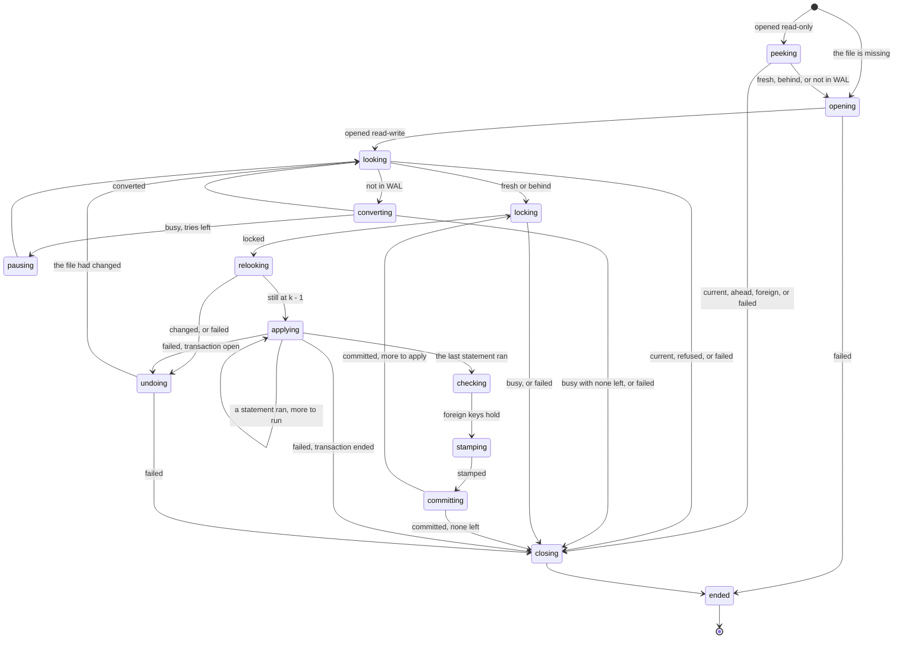

# Slice 2: migrations, and the CLI's `migrate`

Date: 2026-11-23
Status: accepted (owner, 2026-11-23); the build is under way. Revised twice before
that, each time on an adversarial review (the last section).

Read with [global-constraints.md](global-constraints.md) and
[progress.md](progress.md).

## Summary

- `techo migrate` brings a database file to the schema this binary expects.
- `techo serve` refuses to start on a database that is not at that schema.
- The rules every later table follows are written down once.
- **The migration process is a state machine, modelled and verified** (owner,
  2026-11-23): a pure step function makes every decision, and the suite explores
  every order in which two runs, a failure and a crash can meet.
- This slice needs no worker thread, so it does not wait for circuit.

## Decisions for the owner

Each has a recommendation. The rest of this plan assumes the recommendations.

**All five are accepted** (owner, 2026-11-23).

### D1. Split the doorway out of slice 2

ADR-0008's amendment put the database doorway (the write and read workers) in slice 2.
But nothing in "schema, migrations, `migrate`" needs a worker:

- The CLI is its own process with its own connection (ADR-0008, point 6).
- `serve` can check the schema before the loop starts, on a connection it opens and
  closes.

**Recommended:** slice 2 stays as titled and is built now. The doorway becomes
**slice 2b**, which waits for circuit's W2 slice. "2b" and not a renumbering, because
the records already name slices 3 to 9 by number.

Against: keep them together. Then nothing is built until circuit's W2 lands.

### D2. Tables arrive with the slice that uses them

**Recommended:** slice 2 ships the machinery and one migration, which only marks the
file as Techo's. Each later slice brings its own migration with the code and tests
that use it. Slice 2 also writes [schema.md](schema.md): every v1 table sketched, each
marked decided or open, so the whole shape is seen up front without being frozen.

Why: several shapes are still open (the node lifecycle's states, a Contact's fields,
how tags are stored). A table created now would be a guess that a later migration
rewrites, with no code yet to test it.

Against: create the node core now (accounts, nodes, revisions, changes), as the spike
measured it. It makes slice 2 larger, and slices 3 to 8 would begin by altering it.

### D3. Ids are stored as 16-byte blobs

This is the ledger's open question for slice 2.

**Recommended:** blobs. An id is in every index and every foreign key, and text is 36
bytes against 16. The spike measured blobs. The API still shows the usual text form;
the conversion is one pure function, in slice 4.

Against: text, which reads more easily in the `sqlite3` shell. `hex(id)` covers that.

### D4. Migrations are Scheme data inside the binary

**Recommended:** a library, `(techo migrations)`, holds a list of
`(version name sql)` rows. One binary is the server and the CLI (ADR-0009), so there
are no `.sql` files to find at run time.

Against: `.sql` files in a directory, found through a setting. One more thing to
mount, and one more way to run a binary against the wrong files.

### D5. The version is SQLite's `user_version`

**Recommended:** the file's own header fields, with no bookkeeping table.

- `user_version` is the number of the last migration applied.
- `application_id` is `0x74656368` ("tech"), so Techo can tell its file from another
  program's.

Both are written inside the migration's transaction and roll back with it (probed on
SQLite 3.53.1 in the container).

Against: a `migrations` table with names, times and checksums. It would catch a
shipped migration edited after the fact. A rule and a test cover that instead: see
"Rules" below.

## The model

### The shape

- **Every decision is in a pure step function.** `(step state event)` answers the next
  state and one command for the shell.
- **The shell is a loop with no decisions.** It carries out the command with one
  SQLite call, and feeds what happened back in as the next event. Any condition the
  call raises becomes a `failed` event, with one fact beside it: whether a transaction
  is still open.
- **So the model and the code cannot drift.** The suite runs the same step function
  against a small pure model of the file, where it can try every order of events. The
  program runs it against real SQLite, and layer 4 replays the model's traces on real
  connections to compare the two.

This is the shape circuit's worker uses (its ADR-0013), and ADR-0007's.

### Machine 1: the file

What a database file is, read from four facts in **one statement**, so no commit can
land between them: its `application_id`, its `user_version`, how many objects its
schema holds, and its journal mode. `latest` is the last migration this binary knows.

| State | Id | Version | Schema | `migrate` | `serve` |
|---|---|---|---|---|---|
| fresh | 0 | 0 | empty | applies all | refuses: run `techo migrate` |
| behind | Techo's | 1 to latest - 1 | any | applies the rest | refuses: run `techo migrate` |
| current | Techo's | latest | any | nothing to do | serves |
| ahead | Techo's | above latest | any | refuses: this binary is older | refuses: this binary is older |
| foreign | every other combination | | | refuses: not Techo's file | refuses: not Techo's file |

- **Foreign** covers another program's id, anything in the schema with no id (a view
  counts, not only a table), a version with no id, Techo's id with version 0, and a
  negative version.
- **The journal mode is a fact beside the state.** A fresh, behind or current file
  that is not in WAL is *unconverted*. `migrate` converts it; `serve` refuses it with
  "run `techo migrate`". A backup made by `VACUUM INTO` is such a file (probed).
- **A file that cannot be opened** is its own answer, with SQLite's reason: missing,
  not a database, or unreadable.

A file moves only by a committed migration, or by a conversion to WAL. An ahead or a
foreign file's main file is never changed: it is only ever opened read-only.

### Machine 2: one `migrate` run

A hand-drawn overview. The generated diagram, in `.plans/machines/migrate.md`, is the
one a test holds to the table.



checking, stamping and committing fail the same two ways as applying.

A row is `(state, event kind) -> (next state, command)`. A pure function,
`event-kind`, sorts each raw outcome into its kind, using the migrations list and the
run's state. So each state and kind pair has exactly one row. A pair with no row
"can't happen": the step function raises on it, and the explorer fails if one fires.

| # | State | Its command | Event kind | Next |
|---|---|---|---|---|
| R1 | peek-opening | open the file read-only, never creating | opened | peeking |
| R2 | peek-opening | | missing | opening |
| R3 | peek-opening | | failed | ended: cannot-open |
| R4 | peeking | read the facts | current, in WAL | closing: nothing |
| R5 | peeking | | refused | closing: refused |
| R6 | peeking | | work to do | reopening |
| R7 | peeking | | failed | closing: failed |
| R8 | reopening | close the read-only connection | done, or failed | opening |
| R9 | opening | open the file read-write, creating it | opened | looking |
| R10 | opening | | failed | ended: cannot-open |
| R11 | looking | read the facts | unconverted | converting |
| R12 | looking | | pending, at k - 1 | locking k |
| R13 | looking | | current | closing: applied, or nothing |
| R14 | looking | | refused | closing: refused |
| R15 | looking | | failed | closing: failed |
| R16 | converting | set the journal mode to WAL | converted | looking |
| R17 | converting | | busy, tries left | pausing |
| R18 | converting | | busy, none left | closing: busy |
| R19 | converting | | failed | closing: failed |
| R20 | pausing | wait 100 ms | done | looking |
| R21 | locking k | `BEGIN IMMEDIATE` | locked | relooking k |
| R22 | locking k | | busy | closing: busy |
| R23 | locking k | | failed | closing: failed |
| R24 | relooking k | read the facts, under the lock | pending, at k - 1 | applying k, statement 1 |
| R25 | relooking k | | changed | undoing-to-look |
| R26 | relooking k | | failed | undoing-to-fail |
| R27 | applying k, i | run statement i of migration k | ok, more statements | applying k, i + 1 |
| R28 | applying k, i | | ok, the last | checking k |
| R29 | applying k, i | | ok, but it ended the transaction | closing: failed k |
| R30 | checking k | `PRAGMA foreign_key_check` | clean | stamping k |
| R31 | checking k | | violations | undoing-to-fail |
| R32 | stamping k | set `user_version` to k | ok | committing k |
| R33 | committing k | `COMMIT` | ok, k below latest | locking k + 1 |
| R34 | committing k | | ok, k is latest | closing: applied |
| R35 | applying, checking, stamping, committing | | failed, transaction open | undoing-to-fail |
| R36 | the same four | | failed, transaction ended | closing: failed k |
| R37 | undoing-to-look | `ROLLBACK` | done | looking |
| R38 | undoing-to-look | | failed | closing: failed |
| R39 | undoing-to-fail | `ROLLBACK` | done, or failed | closing: failed |
| R40 | closing | close the file | done, or failed | ended, with its result |

- **R35 and R36 are four rows each in the table as data.** They are folded here.
- **The first look is read-only (R1 to R7).** Closing a read-write connection folds a
  leftover `-wal` into the main file, even when nothing was written. So a file that
  will be refused is never opened read-write (probed: another program's file grew
  from 8 KB to 11 MB under a read-write look, and stayed identical under a read-only
  one).
- **R24 is the row that matters.** The looks before it are taken without the lock, so
  another run may have moved the file since. The look under the lock is the one acted
  on. A probe saw the file change between the two in 56 of 300 races.
- **In relooking, anything but "pending, at k - 1" is "changed".** The run undoes and
  looks again from the start, which then sorts the file properly.
- **The conversion comes after a look that accepted the file.** Two runs converting a
  new file at once is the one place SQLite answers busy without waiting (probed: 5 of
  60 races). So R17 tries again. A run starts with 3 tries, and they do not reset.
- **A migration is a list of statements, run one at a time (R27).** After each, the
  shell reports whether the transaction is still open. A statement that ended it is
  R29. Run as one script, a `COMMIT` in the middle left half a migration in the file
  with no stamp, and every later run then failed (probed).
- **A failure may end the transaction by itself:** a full disk, an interrupt, `insert
  or rollback` (probed). A `ROLLBACK` then raises. So the shell reports whether a
  transaction is still open, and R36 skips the undo.
- **A `ROLLBACK` that fails ends the run as failed (R38, R39).** The close that
  follows drops whatever the connection still held.
- **Migration 1's one statement sets `application_id`.** So the id needs no row of its
  own: it commits or rolls back with version 1.
- **`migrate`'s read-write connection has foreign keys off,** and R30 checks them
  before each stamp. SQLite cannot rebuild a table safely with them on: the rebuild's
  `DROP` cascades and deletes the children (probed), and the setting cannot change
  inside a transaction.

**Results.** Each carries the versions whose `COMMIT` answered ok, and whether the run
converted the file, so both are always printed.

| Result | Exit status |
|---|---|
| applied, nothing | 0 |
| refused, failed, busy, cannot-open | 1 |

- failed carries the migration's number, or none, and SQLite's reason.
- A pure `result->exit-status` holds the table, and a pure `result->lines` the output.
- After a `COMMIT` that failed, the run cannot know the file's version. It says so,
  and says to run `techo migrate` again.

### Machine 3: `serve`'s check

It is R1 to R7 with other endings: opened read-only, one look, closed. Current and in
WAL ends serve. Everything else ends in a refusal that carries its reason: missing,
fresh, behind, unconverted, ahead, foreign, or SQLite's own words. It never converts
and never locks, and has a small table of its own.

### The properties

Safety, each an invariant the explorer checks in every world. M1, M3 and M6 are stated
of files that began fresh, or as Techo's.

| # | Property |
|---|---|
| M1 | The file's version is n exactly when migrations 1 to n, and no others, have taken effect in it, each whole. |
| M2 | A migration takes effect at most once, however many runs there are. |
| M3 | Migrations take effect in order, with no gap. |
| M4 | The version never goes down. |
| M5 | An ahead or a foreign file is opened only read-only, and its main file never changes. |
| M6 | The file has Techo's id exactly when its version is 1 or more. |
| M7 | A run that dies at any step leaves the file as its last commit left it. |
| M8 | A run ends applied or nothing only if the file is current at its end: it last looked and saw current, or its own last commit made it so. |
| M9 | `serve` starts only on a current file in WAL. |
| M10 | A run holds the lock and a transaction exactly in relooking, applying, checking, stamping, committing and the two undoing states, and in closing after a rollback that failed. It holds neither anywhere else, and never once ended. |
| M11 | A run's result lists exactly the versions whose `COMMIT` answered ok. |
| M12 | `serve`'s check opens only read-only. It never changes the main file and never creates one. |

Liveness, assuming a lock's holder ends or dies:

| # | Property |
|---|---|
| ML1 | Every run that does not die ends, with one of the six results. |
| ML2 | With no failure, no death and no busy, the file ends current and in WAL, unless it is ahead or foreign. |
| ML3 | No file state is stuck: from any state the explorer reaches, a new run with no failure makes it current, unless it is ahead or foreign. |

- **A failed `COMMIT` may still have taken effect.** The run reports failed k, and the
  next run finds k applied. The model lets a failed commit go either way, and every
  property holds in both. M11 is worded for this.
- **A read-only open of a WAL file may leave `-wal` and `-shm` files beside it**
  (probed). M5 and M12 are about the main file.

### What the model assumes of SQLite

Each clause is held by a row against real SQLite, so a pin move that changes one turns
it red. All are probed already.

1. A transaction's changes take effect together or not at all, the header's
   `user_version` and `application_id` included.
2. Creating and dropping tables is part of the transaction.
3. `BEGIN IMMEDIATE` lets one connection in. Another waits up to its busy timeout,
   then is told busy.
4. A connection outside a transaction sees only what is committed, and one statement
   sees one moment.
5. A failure inside a transaction either leaves it open or ends it, and
   `in-transaction?` says which.
6. A process that dies inside a transaction leaves none of it in the file.
7. A new file reads id 0, version 0 and an empty schema.
8. Setting the journal mode to WAL is told busy at once while another connection
   holds the write lock.
9. A read-only open never creates a file. It reads a WAL file with no `-wal` or `-shm`
   beside it, and it never changes a main file, a leftover `-wal` or not.
10. `PRAGMA foreign_keys` is ignored inside a transaction, and `PRAGMA
    foreign_key_check` there names a dangling row.
11. A WAL file whose writer died leaves a `-wal` holding commits not yet in the main
    file. The next open sees every one of them, read-write or read-only, and a
    migration then applies on top (probed with `kill -9`: 56,150 rows in 1,123
    commits, all there, with the `-shm` lost too).

Clauses 6 and 11 need killed processes, so their rows are in the integration suite.

### Verification, in layers

1. **Static checks on each table.** No state and event kind pair has two rows. Every
   pair with no row is on a list of "can't happen" pairs, each with its reason. Every
   state can be reached. `ended` can be reached from every state. `event-kind` is
   tested over every raw outcome.
2. **Every row driven** against the step function, and every "can't happen" pair seen
   to raise.
3. **Every small world explored, in the suite.** A world holds:
   - the file: its committed effects as an ordered log, its id, version and journal
     mode;
   - the lock's holder;
   - up to two `migrate` runs and one `serve` check, each at its place in its table.
     A run in a transaction has its own uncommitted effects and stamp, which only it
     sees;
   - ghost state: which commits answered ok to each run, for M11.

   From each world the explorer tries every event that can happen next:
   - any run taking its next step;
   - any command failing, with the transaction left open or ended;
   - a migration of two statements whose second fails, so its partial effects are
     there to be rolled back;
   - a failed commit that took effect, and one that did not;
   - busy at the lock, only while another run holds it; busy at the conversion, only
     while another run converts or holds the lock;
   - a run dying at any step, which drops its lock and its uncommitted effects.

   The model defines every command outside a transaction too, so a mutant that stamps
   with none open has an effect to be caught by.

   It runs every combination of: a list of 1 to 3 migrations; every starting file
   state, behind at each version, in WAL and not; one run or two; with and without
   `serve`, whose one look can land at any point.
   - M1 to M12 are checked in every world, and ML1 to ML3 at every world with nothing
     left to run.
   - A second pass fails on a cycle, so every run is known to end.
   - It may not pass by doing nothing: every row must fire somewhere, and the number
     of worlds has a floor.
   - **Each mutant runs on one small configuration named beside it,** and stops at its
     first violation, which must name the property. The second review's throwaway
     explorer took 40 to 50 s for the whole space and killed each mutant within 16
     steps; whole-space mutant runs took up to ten minutes.
4. **The model's traces replayed on real SQLite.** The shell's one-call executor,
   `perform!`, is exported. A test takes traces from the explorer and from random
   walks, and replays each on two real connections in one thread, in the trace's
   order.
   - The test's connections have a busy timeout of 0, so a `BEGIN` that would wait
     answers busy at once.
   - Its migrations have two or more statements, so partial effects show.
   - A failure is caused for real where it can be: a page limit for a full disk,
     `insert or rollback`, a deferred foreign key at the commit. Where it is injected
     by wrapping `perform!`, the wrapper really rolls back or commits, to match the
     outcome it reports. Busy at the conversion can only be injected.
   - After each step, the command and the event are compared with the model's, and so
     are the file's facts and tables, read through a third connection that takes no
     part.
5. **Real processes.**
   - Two `techo migrate` children at once both exit 0, and the file is current.
   - A child killed inside a migration leaves the file as it was (clause 6). The child
     is a test program, `tests/migrate-child.sps`: it calls `(techo db)` with an
     observer that writes a "ready" file and waits. `techo` itself passes no observer,
     and reads none from its environment or arguments.
   - A writer child, `tests/writer-child.sps`, is killed with a full `-wal`. Every row
     it reported is there after `techo migrate`, and `serve` then starts (clause 11).
   - `techo migrate` on another program's file leaves its main file byte for byte the
     same: once closed cleanly, and once with a leftover `-wal`.
6. **Diagrams from the table.** `.plans/machines/migrate.md` is rendered from the
   rows, and a test fails when the file differs (ADR-0007).

TLA+ is not proposed. There is one lock, and layer 3 covers every order on the real
step function.

### Mutants each layer must kill

| Mutant | Fails |
|---|---|
| R24 trusts the earlier look and skips the look under the lock | layer 3: M2, with two runs |
| the stamp is set before the lock is taken | layer 3: M1 |
| R32 and R33 swapped: commit, then stamp | layer 3: M1 |
| R35 goes on to the stamp | layer 3: M1, by the partial effects |
| after a failure, the run undoes and locks k + 1 | layer 3: the cycle pass, with two runs |
| the classifier calls an ahead file behind | layer 2: the file's table; layer 3: M5 |
| R1 opens read-write | layer 3: M5; layer 5's leftover `-wal` row |
| R16 comes before any look | layer 3: M5 |
| R25 forgets the rollback | layer 3: M10 |
| R17 retries for ever | layer 3: the cycle pass |
| R22 retries for ever | layer 3: the cycle pass |
| R13 answers applied on a file it only read | layer 2: R13's row; layer 3: M11 |
| R33 forgets to record k | layer 3: M11 |
| R29 missing: a statement that ended the transaction goes on | layer 4: a migration with `COMMIT` as its second statement |
| R30 skipped | layer 4: a rebuild trace with a dangling row |
| `serve` accepts behind, or a file not in WAL | layer 3: M9 |
| `serve`'s check opens with `create` | layer 5: the missing file is still missing |
| the classifier calls "Techo's id, version 0" fresh | layer 2: the file's table |
| the schema count counts only tables | layer 2 and `test-db`: a file holding only a view |
| the shell runs a statement outside the transaction | layer 4: a migration whose second statement fails |
| the shell ignores a failed `COMMIT` | layer 4: the deferred foreign key trace |
| any result's exit status changed | `result->exit-status`, over all six |

Two candidates are equivalent, so neither is listed:

- R36 runs the rollback anyway: R39 accepts a rollback that fails, so only the trace
  differs;
- the facts read as three statements: no test can land a commit inside one call. The
  facts' SQL is one exported string, and a test holds that it is one statement.

## What is built

### 1. `(techo machine)`: a table and its step. Pure.

ADR-0007 says a small table library comes with the first machine. This is it.

```scheme
;; Row is (List StateKind EventKind StateKind CommandKind Update)
;;   Update is (StateData EventData -> StateData), pure
;; make-machine : (Listof Row) -> Machine
;; machine-rows : Machine -> (Listof Row)
;; machine-step : Machine State Event -> (values State Command)
;;   State is (Pairof StateKind StateData); Event is (Pairof EventKind EventData)
;;   Command is (Pairof CommandKind StateData)
;; machine-problems : Machine (Listof StateKind) (Listof EventKind)
;;                    (Listof (List StateKind EventKind String)) -> (Listof Problem)
;;   the last argument is the "can't happen" pairs, each with its reason
;; machine->mermaid : Machine -> String
```

- A state has a kind and data: the migration and statement numbers, the versions
  committed, the tries left. The table is over kinds; a row's update changes the data.
- A row's command is the one its next state gives. A machine's first state and command
  come from its own `start` procedure.
- `machine-step` raises an assertion violation on a pair with no row.

The explorer is a test library, `tests/explore.sls`:

```scheme
;; explore : World (World -> (Listof (Pairof Label World)))
;;           (World -> (U #f String)) (World -> (U #f String))
;;           -> (U (List 'ok Natural) (List 'violated String (Listof Label))
;;                 (List 'cycle (Listof Label)))
;;   the start, the next worlds, the invariant, the check at a world with
;;   nothing next; a violation names its property and gives the shortest trace
```

It catches a raise from the next-worlds procedure and reports it as a violation, since
SRFI-64 would turn the exception into `#f`. Worlds are compared with `equal?`. Slice
2b's shutdown machine will use both.

### 2. `(techo migrations)`: the list and the tables. Pure.

```scheme
;; migrations : (Listof Migration)
;;   Migration is (List Positive-Integer String (Listof String)):
;;   version, name, statements
;; check-migrations : (Listof Migration) -> (Listof Problem)
;; classify : DbFacts (Listof Migration) -> DbState
;;   DbFacts is (List Integer Integer Natural Symbol):
;;   application_id, user_version, objects in the schema, journal mode
;; facts-sql : String
;; RawOutcome is (List Symbol Any Boolean):
;;   ok, busy, missing or failed; a value (the facts, the violations, a
;;   reason); and whether a transaction is open after
;; event-kind : (Listof Migration) State RawOutcome -> EventKind
;; run-rows : (Listof Row)
;; check-rows : (Listof Row)
;; run-start : -> (values State Command)
;; check-start : -> (values State Command)
;; run-step : (Listof Migration) State RawOutcome -> (values State Command)
;; check-step : (Listof Migration) State RawOutcome -> (values State Command)
;; Result is (List Symbol (Listof Positive-Integer) Boolean Any):
;;   applied, nothing, refused, failed, busy or cannot-open; the versions
;;   committed; whether it converted; and a detail
;; result->exit-status : Result -> (U 0 1)
;; result->lines : Result -> (Listof String)
```

`check-migrations` holds the list:

- versions run 1, 2, 3 with no gap and no repeat, and no name or statement is empty;
- no statement's first word is `BEGIN`, `COMMIT`, `END`, `ROLLBACK`, `SAVEPOINT`,
  `RELEASE`, `ATTACH`, `DETACH`, `VACUUM` or `PRAGMA`. A trigger's `BEGIN ... END` is
  inside a `CREATE`, so it passes;
- the one exception is migration 1, whose single statement is the `PRAGMA` that sets
  the id, built from the constant.

A test holds the shipped list to a recorded copy, `tests/shipped-migrations.scm`.

### 3. `(techo db)`: the shell.

```scheme
;; open-techo-db : String Symbol -> Database
;;   'read-write, 'read-only or 'migrate; sets the busy timeout, synchronous
;;   full, and foreign keys: on, but off for 'migrate. Sets no journal mode.
;;   'read-only never creates. 'migrate creates.
;; read-db-facts : Database -> DbFacts            ; facts-sql, one statement
;; make-shell : String -> Shell                   ; the path, and no connection yet
;; perform! : Shell Command -> RawOutcome         ; one SQLite call
;; migrate! : (case-> (String (Listof Migration) -> Result)
;;                    (String (Listof Migration) (Command -> Void) -> Result))
;; check-db : String (Listof Migration) -> (U 'serve (List 'refuse Symbol String))
```

- `migrate!` is `run-step` and `perform!` in a loop. The optional third argument is an
  observer, called before each command. Only tests pass one.
- `perform!` turns any condition from its one call into a `failed` outcome. It tells a
  missing file from one it cannot open with `file-exists?`.
- The opens are commands, so the step function sees them fail. The loop closes
  whatever is open in a `dynamic-wind`, so a bug that raises out of it still drops any
  open transaction.
- The settings live here once. Slice 2b's workers open their connections with
  `open-techo-db`.

### 4. The first migration

Version 1, "techo's database": its one statement sets `application_id`, and it creates
no table.

### 5. `techo migrate`

- Looks at `TECHO_DB_PATH`, creating the file if it is missing. Its directory must
  exist.
- Prints `result->lines`: a line if it converted the file to WAL, one line for each
  migration applied, then how the run ended and the version the file is at.
- Exits by `result->exit-status`, and 2 for a refused environment, as every command
  does.

### 6. `techo serve` checks first

- Techo's own settings are checked first, as now. Then `check-db`. Then the server
  starts, and reads its own settings.
- Each refusal has its own line on standard error, exit 1:
  - missing, fresh, behind or unconverted: run `techo migrate`;
  - ahead: this binary is older than the database;
  - foreign, or not a database: not Techo's file;
  - anything else: SQLite's reason. A database in a read-only directory is one: a WAL
    file cannot be read there.

`/health` stays as it is. It gains a database check in slice 2b.

### 7. Records and docs

- **ADR-0012:** D2 to D5, the model's shape, and the rules below.
- **ADR-0008, amended:** D1.
- **`.plans/schema.md`:** the v1 tables sketched, each marked decided or open with the
  slice that owns it.
- **`.plans/machines/migrate.md`:** the generated diagrams. Task 2 owns it.
- **`docs/running.md`:** `techo migrate`, in a few lines: run it before the first
  start, after each upgrade and after restoring a backup, with the server stopped.
- **The ledger, the outline's slice list, the global constraints, CHANGELOG.**

## Rules this slice makes

These go into ADR-0012 and the global constraints.

- **A shipped migration is never edited.** A change is a new migration. A test holds
  every shipped migration to a recorded copy, so an edit turns it red.
- **Migrations only go forward.** There is no "down". A migration that fails is rolled
  back by its transaction. To undo one that succeeded, restore a backup.
- **A migration is a list of single statements.** None begins or ends a transaction,
  attaches a database, or is a `PRAGMA`.
- **Stop the server before migrating.** The server checks the schema only at its
  start. Nothing stops a `migrate` beside a running server: it succeeds, and the
  server meets the new schema at its next read (probed). Slice 2b can close this.
- **Table conventions,** for every later migration:
  - `STRICT` tables;
  - ids are 16-byte blobs;
  - times are whole milliseconds since 1970, UTC;
  - JSON is text with a `json_valid` check;
  - every owner-scoped table's indexes begin with the owner;
  - foreign keys are declared, and enforced on every connection but `migrate`'s,
    which checks them before each commit.

## Suites, each test watched failing first

| Suite | Layers | What it holds |
|---|---|---|
| `test-machine.sps` | | The table library on small tables of its own: a double row, an unlisted gap, an unreachable state and a dead end are each named. The explorer on a small world: a violation's shortest trace, a cycle, a raise. |
| `test-migrations.sps` | 1, 2, 6 | The tables' static checks. Every row driven. The classifier over every combination of id, version (negative too), schema count and journal mode. `event-kind` over every raw outcome. `check-migrations`, a trigger's `BEGIN ... END` accepted. `result->exit-status` and `result->lines` over all six results. The shipped list against its recorded copy. The generated diagram against its file. |
| `test-migrations-model.sps` | 3 | The explorer over the whole space, its floor, its fired rows; each layer 3 mutant on its small configuration. |
| `test-db.sps` | the clauses | Clauses 1 to 5 and 7 to 10 against real SQLite. Clause 8 without a race: the other connection holds `BEGIN IMMEDIATE` on a file not in WAL. `facts-sql` is one statement and answers four columns. The settings read back on a new connection: foreign keys, synchronous, the busy timeout. Every shipped migration run, and the id read back. |
| `test-migrations-replay.sps` | 4 | The model's traces replayed through `perform!`, and the layer 4 mutants. |
| `test-integration.sps`, more rows | 5 | `techo migrate` as a child: output and exit status for fresh, current, ahead, foreign, a restored backup and a missing directory. Two at once. Clauses 6 and 11, with the two child programs. Another program's file, clean and with a leftover `-wal`, left the same. `techo serve` refused, with the right line, on a missing file (still missing after), a fresh one, an ahead one and a restored backup; on a current file it answers `/health`. |
| `test-cli.sps`, more rows | | `migrate` parses; `migrate x` is a usage refusal. |

The existing integration rows start `serve` on a file that does not exist. They will
run `migrate` first. The bad-port row keeps its exit status of 2, since it runs on a
current file.

## Work, and who does it

| # | Task | Model | Files |
|---|---|---|---|
| 1 | `(techo machine)`, the explorer, and their suite | Sonnet | `src/techo/machine.sls`, `tests/explore.sls`, `tests/test-machine.sps` |
| 2 | `(techo migrations)`, layers 1, 2 and 6 | Sonnet | `src/techo/migrations.sls`, `tests/test-migrations.sps`, `tests/shipped-migrations.scm`, `.plans/machines/migrate.md` |
| 3 | The file's model, layer 3 and its mutants | Opus | `tests/migrations-model.sls`, `tests/test-migrations-model.sps` |
| 4 | `(techo db)` and the clauses | Sonnet | `src/techo/db.sls`, `tests/test-db.sps` |
| 5 | Layer 4, the replay, and its mutants | Opus | `tests/test-migrations-replay.sps` |
| 6 | The CLI row, `serve`'s check, layer 5 | Sonnet | `src/techo/cli.sls`, `techo.sps`, `tests/test-cli.sps`, `tests/test-integration.sps`, `tests/migrate-child.sps`, `tests/writer-child.sps` |
| 7 | ADR-0012, the ADR-0008 amendment, `schema.md`, docs, the ledger | the lead | `.plans/` but `machines/`, `docs/`, `CHANGELOG.md` |
| 8 | Read-only adversarial review of the whole slice | Opus | none |

- **Order:** 1; then 2, with 7 beside it; then 3 and 4 side by side, on disjoint
  files; then 5, which needs both; then 6; then 8.
- **Tasks 3 and 5 are on Opus.** The model of the file and the lock, and its
  comparison with real SQLite, are where a wrong assumption would make every check
  pass for nothing.
- **Task 3 mutates a copy of `run-rows`,** which task 2 exports. It does not edit
  task 2's file.
- Agents do not commit.

## As built, where it differs from the above

Found while building. The code and its suites are the truth.

- **`pausing` has a failed row too (R20b),** since every command has one.
- **The 3 tries are retries.** A conversion is attempted up to 4 times, with 3 pauses.
- **Failed with the transaction open is the event kind `failed`;** with it ended,
  `failed-ended`. An ok answer at checking or stamping that ended the transaction is
  `failed-ended`.
- **The run table is 51 rows as data, and the check table 12.**
- **R26b is new, and came from layer 3.** A look under the lock that fails and ends
  the transaction went on to a rollback holding neither the lock nor a transaction,
  so M10 was false there. Neither review saw it; the exploration found it in 7 steps.
  That case now closes at once, as R36 does. An ok look whose transaction is gone
  takes the same row.
- **R14 never fires in the model.** A run looks read-write only after its read-only
  look accepted the file, so only another program writing in between reaches it. It
  stays, as a defence, and the suite names it as the one row not fired.
- **The mutant "R16 comes before any look" is not caught by M5** now that the first
  look is read-only. Converting on the read-only connection is caught by ML2 and
  ML3; converting right after the read-write open is equivalent for every property.
  The suite pins all three outcomes.
- **"Stamp before the lock" is caught by M10 first,** and by M1 with M10 off.
- **The suite explores 6 of the 14 list shapes:** 2.96 million worlds over 456
  configurations, in about 33 s. All 14 passed in a one-off run: 9.7 million worlds,
  95 s.
- **Not taken:** a `ROLLBACK` that answers ok with the transaction still open. SQLite
  cannot answer so, and the close that follows drops the transaction.
- **Layer 4 replays 818 traces, 8,656 steps,** covering every row but R14, in about
  7 s. It found no disagreement between the model and SQLite on any path `migrate`
  takes.
- **R29 does not save a migration that holds a `COMMIT`.** The statements before it
  are committed by then, with no stamp. The model's "ok, but the transaction ended"
  means a rollback. `check-migrations` on the shipped list is the guard, and a test
  holds it.
- **The model is wrong off `migrate`'s paths in one place:** `BEGIN IMMEDIATE` on a
  read-only connection answers ok in SQLite and fails in the model. No run begins on
  a read-only connection. The replay holds this as an expected failure.
- **In delete mode a reader can be told busy** while a writer's cache has spilled. The
  model has a failed read there, which takes the same row.
- **`explore` takes a hash function,** since Chez's `equal-hash` reads only the start
  of a value ([traps.md](traps.md)).
- **`result->progress-lines` and `result->ending-lines`** split a result's output, so
  the program sends progress to standard output and a refusal to standard error.
- **The step function gives the shell ready commands,** such as
  `(run-statement . sql)` and `(stamp . k)`, so the shell holds no migrations list.
  `make-stepper` builds a step function from rows and a classifier, which is how the
  model's tests run a mutant.
- **`application_id` is 1952801640 in decimal.**
- **`make machines`** writes the generated diagrams.

## Not in this slice

- The doorway, the workers, the shutdown machine and T1 to T5: slice 2b.
- Any table. Each arrives with its slice (D2).
- `techo backup`: slice 9.
- A setting for the busy timeout. It is a constant, 5000 ms, until something needs
  otherwise.

## For slice 2b, noted while planning this one

- `open-techo-db` sets no journal mode, so a worker's set-up must refuse a file that
  is not in WAL, as `serve`'s check does.
- `synchronous full` makes each commit wait for the disk, which is the 31 second
  stall. `normal` in WAL never corrupts the file, but can lose the last commits on a
  power cut, which the restated T5 does not allow. Full is the default here; 2b
  decides.
- `interrupt-database!` may be called from any thread. It is how a read that has run
  past its deadline can be stopped, so that it does not hold back the checkpoint.
- chez-sqlite3's `with-transaction` rolls back when its body raises or leaves, which
  is what T1 needs (read in its source at the pin).

## The reviews

### The first

An adversarial, read-only review on Opus read the first draft, with probes in
`build/review-plan/`, which is git-ignored. I reran its probes, and each reproduced.
It found four blocking flaws, eleven to fix and nine minor. Taken in above:

- **Blocking:**
  - two runs on a new file: one was told busy at the open, with no row for it (the
    converting rows, now R16 to R20; clause 8);
  - the open converted another program's file to WAL before the refusal, and `serve`
    could not open a file not in WAL, such as a restored backup (the journal mode as
    a fact; M5 widened; M12);
  - a failure can end the transaction, and the rollback then raised on a pair with no
    row (now R29, R35 and R36; clause 5);
  - layer 4 could not be built on a `migrate!` that is the whole loop (`perform!`,
    the observer, the replay as its own task after the model).
- **Fixed:**
  - the facts read as three statements could see a moment no commit made;
  - M8 was false on the success path;
  - the table library could not hold guards or a state's data (event kinds, updates);
  - outcomes with no row, each a crash with exit 255 (a failed row for every command);
  - `call-with-database` hid the open from the step function;
  - a table rebuild with foreign keys on deletes the children (now R30; `migrate`'s
    connection);
  - mutants whose named layer would not kill them, and six with no killer;
  - what the explorer's world must hold;
  - M1 and M6 scoped; M10 by state; M11 and M12 new;
  - the kill test's hook kept out of the binary (`tests/migrate-child.sps`);
  - the work split: the replay after the model, one owner for the diagram's file.
- **Minor:** `serve`'s line for each refusal; negative versions; a run's progress
  always printed; the order of `serve`'s checks; a failed commit that took effect; the
  id checked by running migration 1; the explorer naming a "can't happen" raise;
  `synchronous` read back.
- **Not taken:** moving `schema.md` out of the slice. It is the lead's task, beside
  the builders, and D2 asks for it.

### The second

The second review was on Fable, read-only, and of another shape: it transcribed the
tables into a throwaway program, explored 2.6 million worlds, and played an operator
through ten scenarios on real SQLite. Its probes are in `build/review-plan-2/`. I
reran the ones behind its two blocking findings, the killed-writer probe and the
statement probes, and each reproduced. It found the table sound: no cycle, every row
firing, and M1 to M10, M12, ML1 and ML3 holding in every world. Taken in above:

- **Blocking:**
  - M11 was false in the case the plan itself names, a failed commit that took effect
    (M11 reworded; the run says the version is unknown);
  - a read-write look folded a leftover `-wal` into another program's file, so M5 and
    the byte-for-byte row were false (the first look is read-only: R1 to R8).
- **Fixed:**
  - the text check on a migration's SQL refused triggers and missed `COMMIT; BEGIN`
    (a migration is a list of statements; R27 to R29);
  - a failed `ROLLBACK` broke M10 (R38, R39; M10 reworded);
  - three mutants not killed where named (restated, and two equivalents listed);
  - whole-space mutant runs would not fit the suite's time limit (one small
    configuration each);
  - the row shape could not hold "as its row said" (two undoing states);
  - eight tests that could not be written as described (the facts' SQL as one string;
    clause 8 without a race; clauses 6 and 11 in the integration suite, with a writer
    child; a third connection, real effects and longer migrations in the replay).
- **Minor:** the tries and the pause; the shapes of a command, an outcome and a
  result; a machine's first command; the explorer's interface; the recorded copy's
  file; ML2's wording; a refusal's reason; a missing file told from an unreadable one;
  the conversion printed.
- **Found sound, and new:** clause 11. A database killed mid-write in WAL loses
  nothing, and migrates.
- **Left as a rule, not closed:** `migrate` beside a running server.

### The third, of the build

An adversarial, read-only review on Opus read the built slice, planted twelve mutants
of its own and drove the binary through fourteen operator scenarios. Its probes are in
`build/review-slice-2/`. It found one blocking flaw, six to fix and nine minor. It
found sound: the model's reduction (switched off, the verdicts were the same), the
hash, each property's check but M7's, the replay's injections, and every row against
this plan.

- **Blocking, fixed:** a trailing slash in `TECHO_DB_PATH`. Chez called the file
  missing, SQLite opened it, and so the first open was read-write: another program's
  leftover `-wal` was folded into its file. The path may no longer end in a slash.
- **Fixed:**
  - no test held that a close drops an open transaction and does not commit it (two
    tests now read the file after);
  - clause 11's row never applied a migration on the recovered file (it does now);
  - a leading `;` or a byte order mark hid `COMMIT` from `check-migrations`;
  - the index rule was false of a primary key's own index (reworded);
  - the docs' table of refusals.
- **Decided (owner, 2026-11-23): a hot rollback journal is named, not recovered.** A
  file in rollback mode whose writer was killed mid-transaction is refused by
  `migrate` and `serve` alike until a read-write open rolls the journal back. The
  bytes are never changed. SQLite's text for it, "attempt to write a readonly
  database", is replaced by a line that says what happened and what to do. A restored
  backup that was copied badly is how one would arise.
- **Recorded, not fixed:**
  - M7 is held by layer 5's killed child, not by layer 3, whose ghost only a model
    mutant sets;
  - layer 3 has no property tying a result's kind to the file, nor one for foreign
    keys. Layer 2's rows and layer 4 hold those;
  - the binary's printing on a failing run that made progress has no test, since no
    such run can be provoked without an observer;
  - the plan's "page limit for a full disk" was not built into the replay. Probed by
    hand: failed, the version at the last commit, no partial table;
  - Ctrl-C during a migration exits 255 and prints nothing. The transaction is rolled
    back;
  - a file that is not a database says "cannot open the database", not "not Techo's";
  - the "can't happen" reasons are generated, not written one by one.

## Done when

- `scripts/guix-env make test` passes, with the new suites.
- `make check-pins` and CI pass.
- The review's findings are fixed or recorded.
- The ledger has the close-out.
