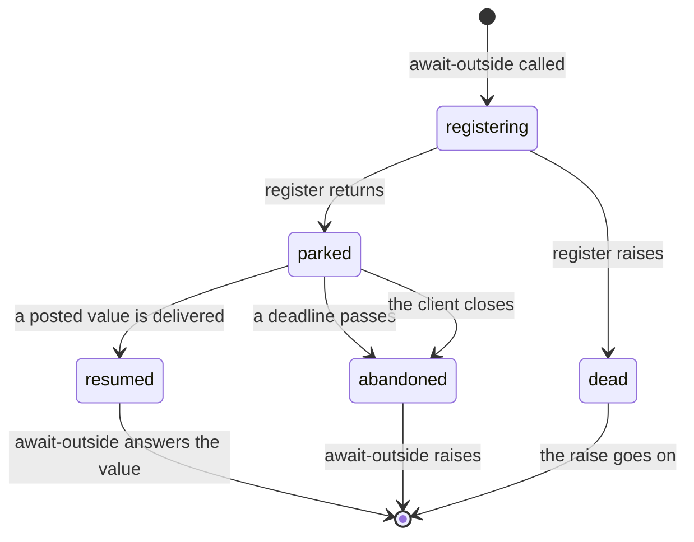
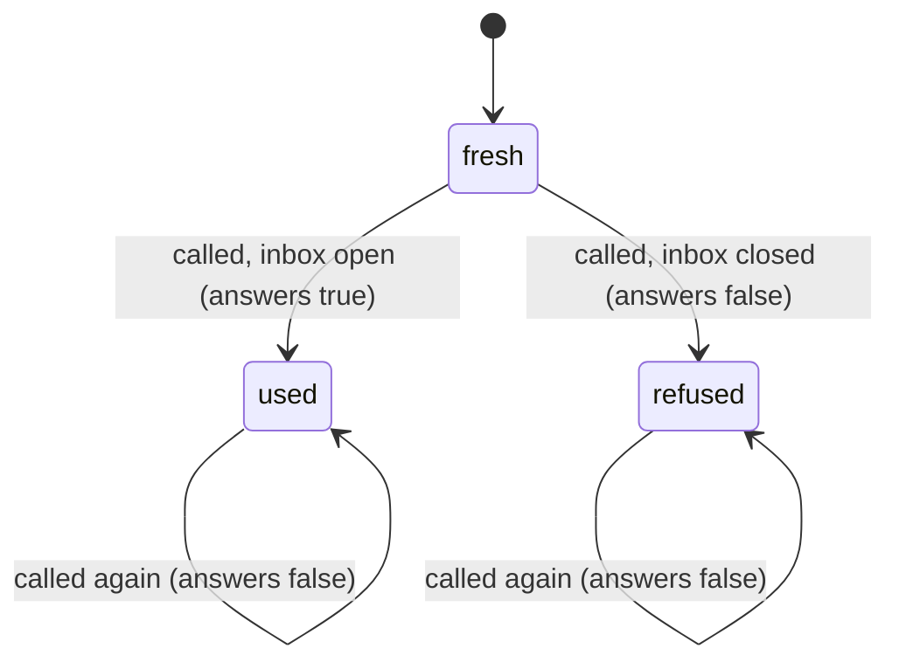
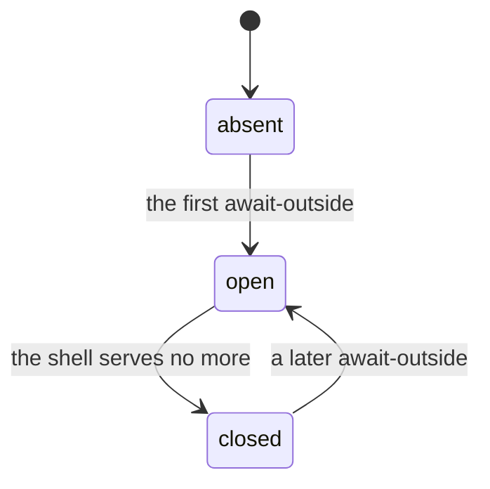
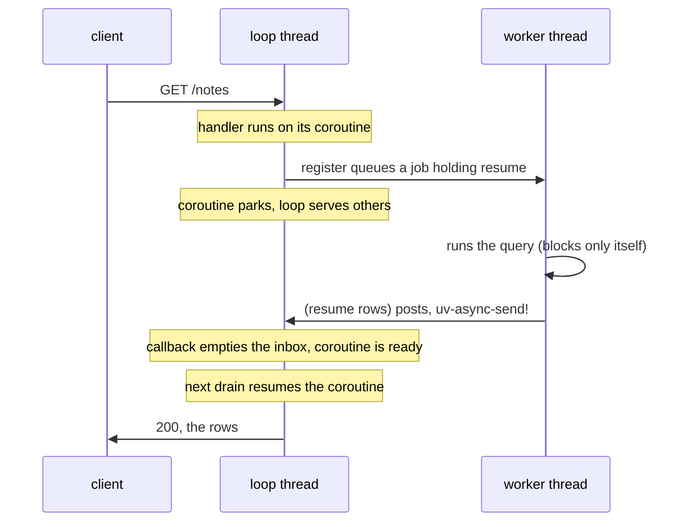
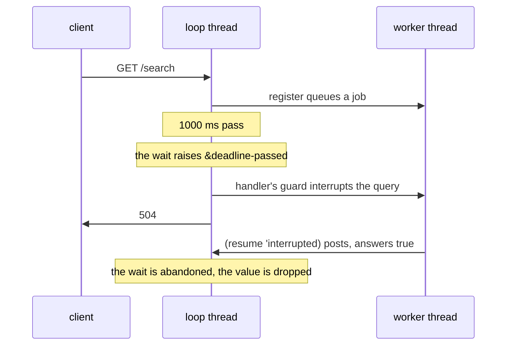

# Proposal: a handler can be woken from another thread (`await-outside`)

Date: 2026-11-22
Status: draft, for chez-http-server's owner to accept, change or refuse
From: Techo's planning
Read against: chez-http-server at `12e8a6f`, circuit at `481f593`, chez-libuv 0.11.0.
Nothing here was run. Every claim about today's code names the file it was read in.

`await-outside` is a working name. So is every other name this proposal introduces.

## 1. In one paragraph

A handler can already wait for something the loop's thread does. It cannot wait for
something **another thread** does. This proposal adds one verb, `await-outside`, whose
`resume` may be called from any thread. With it a handler hands blocking work to a
worker thread, parks, and is woken with the answer, while the loop serves everyone
else. The server gains one async handle per loop and a small locked inbox. Nothing
about today's `await` changes.

## 2. Why

**A blocking call in a handler stops the whole server.** The server is one loop on one
thread (`docs/how-it-works.md`). circuit's `docs/waiting.md` measures it: while one
handler slept 2 s with Chez's own `sleep`, a request for `/` took 1.7 s.

**Some work can only block.** Techo has two cases, and most applications will have the
first:

| Work | Why it blocks | How long |
|---|---|---|
| A SQLite query, through chez-sqlite3 | `sqlite3_step` is a C call | microseconds to seconds |
| A password hash, argon2id | slow on purpose | 100 ms or more |

Neither can be turned into a wait on the loop. A SQLite connection has no file
descriptor to poll, and a hash is pure CPU.

**Today there is no way out.** Three facts, read in the source:

1. `resume!` is not safe off the loop's thread. It changes the wait's cell, then calls
   `coroutine-wake!`, which changes the scheduler's ready queue, with no lock
   (`src/http-server/private/waits.sls`, `src/http-server/private/scheduler.sls`).
   Decision 0015 item 1 says so: `resume` is called "by anything the loop's thread
   runs".
2. A resume from another thread would not wake the loop even if it were safe. With
   nothing ready, the turn polls with `uv-run` in `'once`, and sleeps until libuv has
   something (`scheduler-turn!`).
3. An application cannot reach the loop to fix this itself. `serve` makes the loop;
   `start-server`, which takes one, is in `(http-server private serve)`; and the facade
   exports no libuv name or handle (decision 0003, `tests/test-exports.sps`).

**The door was left open on purpose.** Decision 0003 rejected OS-thread handlers for
v1, and says a worker pool for blocking or CPU-heavy handlers "becomes admissible" once
chez-libuv had `__collect_safe` and `uv_async`. Both shipped in chez-libuv v0.6.0, and
the decision's dated note says: "The worker-pool route is admissible from this pin on."

**Why this primitive and not a worker pool.** A pool does not fit every case. Techo's
database worker must be one thread that owns its connection, because chez-sqlite3 binds
a connection to the thread that opened it. The server should give the one thing only it
can give, a safe wake, and leave threads, queues and pools to the layer above (§9).

## 3. What is asked for

### 3.1 The verb

```scheme
;; await-outside : ((Any -> Boolean) -> Any) -> Any
(await-outside register)
```

- `register` is called once, on the coroutine, with `resume`.
- The coroutine then parks until `resume` is called, and `await-outside` answers what
  `resume` was given.
- **`resume` may be called from any thread**, the loop's own included.
- It is refused where `await` is refused, before `register` runs: inside a libuv
  callback (R1), on no coroutine (R2), inside a feed (R5).
- It is exported by `(http-server)`, beside `await`.

### 3.2 What `resume` promises

```scheme
;; resume : Any -> Boolean
```

| `resume` answers | Meaning |
|---|---|
| `#t` | The value was posted. The loop will look at it. |
| `#f` | Nothing was posted: this `resume` was already called, or the server has stopped taking posts. |

- **`#t` does not mean the handler saw the value.** The wait may have ended first, by a
  deadline or the client's close. The value is then dropped.
- `resume` never raises, never blocks beyond a short lock, and never runs handler code.
  It only posts.
- The value crosses as it is: threads share one heap. What the two threads may both
  touch afterwards is the application's to guard.

### 3.3 What stays the same

- `await`, `sleep-ms`, `with-deadline`, `resolve` and the body's verbs are untouched.
- A deadline or a client's close ends an outside wait exactly as it ends any wait: the
  wait raises `&deadline-passed` or `&client-closed`.
- Everything else stays loop-thread only: request accessors, transports, responses, and
  the `resume` of a plain `await`. **`resume` from `await-outside` is the single thing
  callable off the loop's thread.**

### 3.4 How it would work inside

One inbox per loop, made at the first outside wait, as the waits' timer is made at the
first timed wait (`loop-clock!` in `src/http-server/private/shell.sls`).

- **The inbox** is a mutex, a queue and an open flag, plus one async handle from
  `make-uv-async`. This is the recipe chez-libuv's `docs/threads.md` gives under "Wake a
  loop from another thread".
- **`resume`, on any thread:** take the mutex; if the flag is set and this `resume` is
  unused, queue `(cell . value)`, mark it used, and call `uv-async-send!`.
- **The handle's callback, on the loop's thread:** take the mutex, empty the queue,
  release it, then give each item to the existing `resume!`. A callback only wakes,
  which only makes a coroutine ready, so R1 holds.
- **The coroutine runs at the next drain**, which follows the poll in the same turn.

The async handle is libuv's, so it stays inside the shell. Waits get an injected
`post` procedure, as they get a clock and a resolver (`waits-clock!`,
`waits-resolver!`). The fake shell injects its own.

## 4. Expected behaviour, as three small machines

### 4.1 The wait

What one `await-outside` goes through. Every transition is on the loop's thread.



| State | Event | Next | What happens |
|---|---|---|---|
| registering | `register` returns | parked | The coroutine parks. |
| registering | `register` raises | dead | The raise leaves `await-outside`. No wait began. |
| parked | a posted value is delivered | resumed | The coroutine is ready; `await-outside` answers the value. |
| parked | a deadline passes | abandoned | `await-outside` raises `&deadline-passed`. |
| parked | the client closes | abandoned | `await-outside` raises `&client-closed`. |
| abandoned | a posted value is delivered | abandoned | Dropped. Not a fault: §4.4. |
| dead | a posted value is delivered | dead | Dropped. |
| resumed | a posted value is delivered | resumed | Cannot happen: §4.2 posts once. If it does, log `late-resume await-outside`. |

**A value never arrives while registering.** `register` runs on the loop's thread, and
a posted value is delivered only by the handle's callback, which that same thread runs
later. So the `'early` state a plain `await` has (a resume called inside `register`)
does not exist here, even when `register` calls `resume` itself: the value is posted
and delivered at the next poll.

### 4.2 The `resume` procedure

What one `resume` goes through. Transitions happen on whichever thread calls it, under
the inbox's mutex.



| State | Event | Inbox | Next | Answer | What happens |
|---|---|---|---|---|---|
| fresh | called | open | used | `#t` | Queue the value; wake the loop. |
| fresh | called | closed | refused | `#f` | Nothing. |
| used | called | any | used | `#f` | Nothing queued. The loop is told to log `late-resume await-outside`. |
| refused | called | any | refused | `#f` | Nothing. |

- A second call is the caller's bug, as it is for `await` (R4). The log line is written
  by the loop's thread, never by the caller's: the server's log is not locked.

### 4.3 The inbox

One per loop.



| State | Event | Next | What happens |
|---|---|---|---|
| absent | first `await-outside` | open | Make the handle. Set the flag. |
| open | a post | open | Queue; send. |
| open | the handle's callback | open | Empty the queue; deliver each item. It may find the queue empty. |
| open | the shell serves no more | closed | Under the mutex, clear the flag. Close the handle. Empty the queue once more. |
| closed | a post | closed | Refused: `resume` answers `#f`. |

- "The shell serves no more" is the point where `release-timer!` already closes the tick
  timer, the waits' timer and the signal handles: no longer listening, no connection
  left.
- The closing order is chez-libuv's, and matters: a close drops wakes still pending, so
  the queue is emptied once more after it.

### 4.4 A resume that comes after its wait ended

This is the one place the proposal departs from today's rule, so it is called out.

- Today, a lookup that a deadline cancelled still answers later, and the server logs
  `late-resume resolve` (`docs/testing.md`, "Lookups").
- For an outside wait this is the **normal** case, not a fault. A worker cannot be
  stopped mid-call, so after a deadline it finishes and posts.
- **Asked for:** the first value posted to an abandoned wait is dropped and not logged.
  Only a second call of the same `resume` is logged.
- If the owner prefers one rule for every wait, the alternative is to log it under a
  name of its own, such as `outside-resume-dropped`, so it can be told from a bug.

## 5. In sequence

A handler asks a worker for a query's rows.



With a deadline that passes first:



## 6. Examples

**One blocking call on a thread of its own.** The simplest use, and a poor one for
anything frequent: a thread per call is costly.

```scheme
(define (hash-password password)
  (await-outside
   (lambda (resume)
     (fork-thread
      (lambda ()
        (resume (guard (e (#t (cons 'raised e)))
                  (cons 'ok (pwhash password)))))))))
```

**A worker that owns a database connection.** The connection is opened on the worker,
since chez-sqlite3 binds it to its thread.

```scheme
;; jobs: a queue guarded by a mutex and a condition, the application's own.
(define (worker-loop db)
  (let next ()
    (let* ((job (take-job!))                 ; blocks the worker only
           (work (car job)) (resume (cdr job)))
      (resume (guard (e (#t (cons 'raised e)))
                (cons 'ok (work db))))
      (next))))

;; On a handler's coroutine.
(define (call-with-db work)
  (let ((answer (await-outside (lambda (resume) (put-job! (cons work resume))))))
    (if (eq? (car answer) 'ok) (cdr answer) (raise (cdr answer)))))
```

**Giving up, and stopping the work.** The handler catches the raise, cancels, and
raises again, as `docs/waiting.md` already teaches for a client's close.

```scheme
(guard (e ((deadline-passed? e) (interrupt-database! db) (raise e)))
  (with-deadline 1000 (lambda () (call-with-db search))))
```

## 7. Traps

Each is a way this goes wrong that the documents should name. The first is the worst.

1. **A worker's blocking C call can still freeze the loop.** Chez collects with every
   active thread stopped. A thread inside a foreign call that is not `__collect_safe`
   counts as active and cannot stop, so the loop's thread waits for it at its next
   collection. Decision 0003 measured the mirror image: a loop blocked in `uv-run`
   froze collection for other threads until chez-libuv made that call collect-safe.
   - So the blocking call itself must be `__collect_safe`. chez-sqlite3 already binds
     `sqlite3_step`, open, close, prepare, reset and finalize that way
     (`src/chez-sqlite3/private/native.sls`, its ADR-0011). chez-sodium's password
     hash must be too.
   - chez-sqlite3's ADR-0011 records the failure: a plain blocking call hung the whole
     process when another thread asked for a collection.
   - This is not chez-http-server's to fix, but its documents should say it, and one
     of its tests should prove the loop stays live (§8.3, property 9).
2. **`register` runs on the loop's thread.** Blocking work done inside `register`
   blocks the server. `register` only hands the work over.
3. **A worker that raises wakes no one.** An uncaught raise ends the worker's thread,
   `resume` is never called, and the handler waits for ever. Catch on the worker and
   post the condition, as §6 does. And put a deadline around every outside wait.
4. **A deadline does not stop the worker.** The handler gets its raise at once; the
   worker runs on. With one worker, abandoned jobs still take their turn and the queue
   backs up. Cancel what can be cancelled (`interrupt-database!`), and bound the queue.
5. **`resume` answering `#t` is not delivery.** It means posted. Never tie a side
   effect to it, such as committing because the client "got" the answer.
6. **Wakes coalesce.** Many posts can produce one callback, and a callback can find the
   queue empty. The inbox handles this; a test must cover it.
7. **Only `resume` crosses threads.** A worker that touches the request, its body's
   port, a transport, or a plain `await`'s resume corrupts the loop's state. Take plain
   data out of the request before handing work over.
8. **Thread parameters do not cross.** A worker sees its own values for Chez's thread
   parameters, and its own current ports. Log from the loop's thread.
9. **`with-mutex` does not hold across a wait.** Already in `docs/waiting.md`: a wait
   leaves every `dynamic-wind` around it. A handler must not hold a lock of its own
   over `await-outside`.
10. **The worker must be a Chez thread.** One made by `fork-thread`. A thread a C
    library created is not active in Chez and cannot call `resume`.
11. **A `resume` kept after the server stops is harmless.** It answers `#f`. The worker
    must not treat that as an error to retry.
12. **Order is per thread only.** Values one thread posts are delivered in the order it
    posted them. Across threads there is no order.

## 8. Testing: what chez-http-server should be able to prove

The behaviour splits in two. The machines of §4 are deterministic and need no thread.
The inbox's locking needs real ones.

### 8.1 Without threads: the fake shell and `(http-server testing)`

The fake shell injects a `post` that queues without a mutex or a handle. The test's own
code plays the worker: it keeps the `resume` a handler registered and calls it between
the host's acting calls.

Asked of `(http-server testing)`:

- A posted value is delivered by the host's next acting call, as a lookup's answer is.
- `(test-host-posted host)`: how many posted values wait to be delivered.
- `(test-host-deliver! host)`: an acting call that only delivers, and runs to quiet.
- `(test-host-stop-posts! host)`: closes the inbox, so a test reaches `refused`.

Every row of §4.1 and §4.2 then becomes one test:

| # | Script | Expect |
|---|---|---|
| 1 | register keeps `resume`; test calls `(resume 7)`; deliver | `resume` answered `#t`; the response carries 7 |
| 2 | `register` raises | the raise reaches the handler; nothing waits |
| 3 | `register` calls `resume` itself | the handler still parks; the value arrives at the next delivery |
| 4 | deadline of 50 ms; advance 50; then `(resume 7)`; deliver | `&deadline-passed`; `resume` answered `#t`; no log line |
| 5 | client closes; then `(resume 7)`; deliver | `&client-closed`; no `handler-failed`; no log line |
| 6 | `(resume 7)` twice | `#t` then `#f`; the handler sees 7; one `late-resume await-outside` logged |
| 7 | stop posts; `(resume 7)` | `#f`; the handler still waits |
| 8 | two handlers wait; resume the second first | each gets its own value |
| 9 | `(resume 7)`, and the deadline passes before delivery | which wins is fixed and stated; the other is dropped |
| 10 | `await-outside` on no coroutine, in a callback, in a feed | R2, R1, R5, before `register` runs |

Row 9 needs a decision: the proposal suggests the deadline wins if it passes before
the delivery, since both happen on the loop's thread in a known order.

### 8.2 The machines as tables

If the owner agrees, §4's tables can be data in the suite: a list of
`(state event next effect)` rows, checked for a reachable, deterministic machine, and
driven row by row against the fake shell. The document's tables are then generated
from the same data, and cannot drift. Techo plans to verify its own machines this way.

### 8.3 With threads: the libuv shell

Real loop, real `fork-thread`, loopback clients.

| # | Property | How |
|---|---|---|
| 1 | Every post is delivered exactly once | N threads each resume M waits; count answers |
| 2 | Coalescing loses nothing | all threads post at once, behind a barrier |
| 3 | A sleeping loop wakes | one wait, nothing else armed; the answer arrives within a bound |
| 4 | A post races a deadline | deadlines near the worker's time; each request gets its answer or 504, never both, never neither |
| 5 | A post races the stop | SIGTERM while workers post; `serve` returns; every late `resume` answers `#f`; nothing raises |
| 6 | No handle is left | after the stop, the loop's live handles are zero, as the suites already check |
| 7 | An idle server stays idle | an open inbox with nothing posted causes no turns |
| 8 | Per-thread order | one thread posts 1 to N to N waits; they resume in order |
| 9 | The loop stays live under a blocked worker | a worker in a collect-safe C sleep; a request for `/` answers in milliseconds, with collections forced |
| 10 | The audits hold | `tests/test-exports.sps`: no libuv name in the facade. `tests/test-imports.sps`: nothing a feed runs reaches the inbox |

Runs under Valgrind and the thread-heavy suites should repeat, since a race shows only
sometimes.

### 8.4 Costs to measure

As decision 0015 measured each wait:

- bytes and CPU per `await-outside`, against `await`;
- the time from `resume` to the coroutine running, at rest and under load;
- what an open, idle inbox costs each turn: it should be nothing.

## 9. What circuit adds on top

Once the server has the verb, circuit can do the rest in portable code plus Chez's
threads.

- **Re-export** `await-outside` from `(circuit http-server)`.
- **A worker**, in a library of its own:

  ```scheme
  ;; make-worker : (-> Any) Nat -> Worker        ; set-up thunk, queue cap
  ;; worker-call : Worker (Any -> Any) -> Any    ; on a handler's coroutine
  ;; worker-stop! : Worker -> Void
  ```

  - One thread and one bounded queue. The set-up thunk runs on the worker's thread and
    its value is passed to each job: a database connection, for example.
  - `worker-call` answers what the job returned, or raises what it raised.
  - A full queue raises a condition a middleware can turn into 503.
- **A pool**, later, for stateless CPU work.
- **`wrap-timeout` already works**: it is a deadline around the handler.
- **For tests**, an inline worker that runs each job at once on the caller's thread, so
  a handler's tests need no thread and stay deterministic.

Techo's database doorway is then one `worker-call`, and its handlers do not change.

## 10. Alternatives considered

| Alternative | Why not first |
|---|---|
| Make `resume` from plain `await` thread-safe | Every wait would pay for a lock it does not need, and the meaning of a resume inside `register` would change. |
| A general "run this thunk on the loop's thread" | More power than is needed: arbitrary code enters the drain from outside. `await-outside` has one narrow contract that fits a table. It could be built later on the same inbox. |
| A worker pool inside the server | Does not fit a worker that owns state, such as a SQLite connection. Belongs above (§9). |
| Hand the application the loop | Breaks decision 0003: the facade exports no libuv name or handle. |
| Pre-forked worker processes | Decision 0003's first route for scale. It does not help one request that blocks: that process still stalls. |
| Do nothing; keep blocking calls short | Techo's v1 plan. Fine for a query of a millisecond; wrong for a password hash, and it leaves a slow query able to stall everyone. |

## 11. Questions for the owner

1. The verb's name.
2. §4.4: is a value posted to an abandoned wait dropped silently, or logged under its
   own name?
3. §8.1 row 9: when a posted value and a deadline are both due, which wins?
4. Should `resume` say more than `#t` or `#f`? A worker could skip its work if it knew
   the wait was already abandoned, but that is a second cross-thread read.
5. Is the inbox made at the first outside wait, or with the loop?
6. Do takers (handlers that took an upgrade) get the verb too, under the rules they
   have for `await`?
7. Does §8.2, the machines as data, fit how the project wants its suites to read?

## 12. Done when

- [ ] `(http-server)` exports the verb, and `docs/waiting.md` and `docs/reference.md`
      describe it, with §7's traps.
- [ ] A decision record states the contract, with §4's tables.
- [ ] `(http-server testing)` has the calls of §8.1, and `docs/testing.md` shows them.
- [ ] §8.1's ten scripts pass on the fake shell.
- [ ] §8.3's ten properties pass on the libuv shell, on Linux.
- [ ] §8.4's costs are in the performance baseline.
- [ ] An example in `examples/` runs a blocking call off the loop.
- [ ] circuit re-exports the verb and ships the worker of §9, with its inline double.
