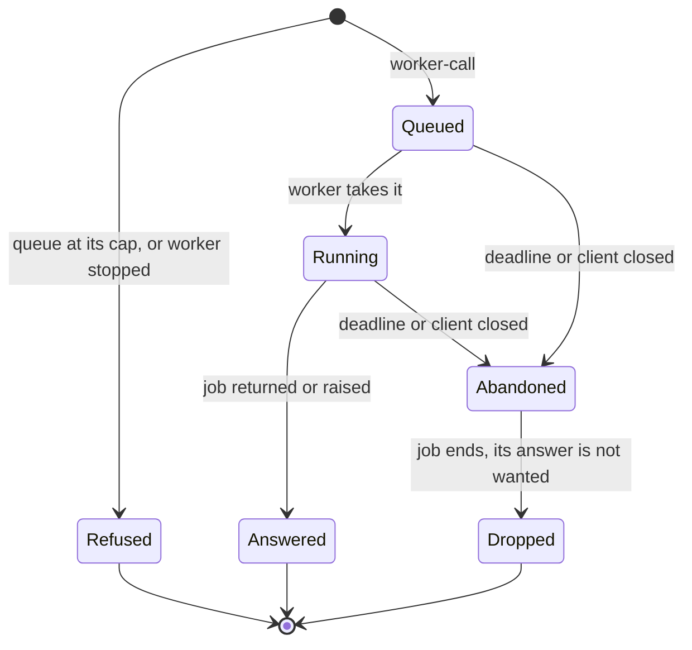

# Brief: circuit takes the server's `await-outside` and ships a worker

Date: 2026-11-22
For: circuit (`../circuit`)
Filed as: https://github.com/Kiyomi-Computation-Systems/circuit/issues/53
This is the snapshot handed over. Once circuit takes it up, circuit's own `.plans/` is
the truth. The application the issue speaks of is Techo (ADR-0008, amended).

## Summary

Three things, in order:

1. Move to chez-http-server v0.12.0, by a temporary exception to ADR-0011.
2. Re-export `await-outside` from `(circuit http-server)`.
3. Ship a worker: one thread that owns some state, a bounded queue in front of it, and a call a handler makes to run a job there.

Item 2 alone unblocks the application that asked. Item 3 is what stops every application writing the same forty lines, each with its own mistakes.

Read against: circuit at `481f593`, chez-http-server v0.12.0 (`bba2ba6`).

## 1. Why

An application on circuit that uses SQLite calls it from a handler, and the call blocks the one loop thread. A spike measured what that costs on a 950 MB database:

| Operation | Median | Worst |
|---|---|---|
| A write, in memory (no disk wait) | 0.3 ms | 25 ms |
| A ranked full-text search for a common word | 13 ms | 141 ms on a larger database |
| A commit on a busy disk | 7 to 9 ms | 31 seconds |

While any of those runs, no other request is served, a health check included. The application cannot bound the disk's wait. chez-http-server 0.12.0 added `await-outside` so the work can leave the loop's thread. circuit stands between the two.

## 2. The dependency: an exception to ADR-0011

- The Akku index lists chez-http-server 0.11.0 as its newest, read 2026-11-22. The owner expects 0.12.0 there in days and decided not to wait.
- **The exception, for this one package:** chez-http-server is a git submodule again, pinned at v0.12.0, written as the full commit `bba2ba6fea252996d31bffc6255d8be36e9bdfd2`. A shallow CI checkout of a submodule brings no tags, so a tag name does not resolve there.
- Every other dependency still comes from Akku. The server's release notes say none of its own pins moved, so chez-libuv, chez-httparse, chez-uri and byte-machine stay as locked.
- circuit's manifest range `^0.11.0` does not admit 0.12.0.

A decision record amending ADR-0011 should say:

- what ends the exception (0.12.0 on the index) and what moves back then;
- how the manifest, `Akku.lock`, the library path and `make check-pins` express one package from a submodule beside the rest from Akku;
- what a consumer does meanwhile. A consumer that repeats circuit's `depends` in its own manifest cannot get 0.12.0 from Akku either.

## 3. Re-export `await-outside`

- From `(circuit http-server)`, beside `await`, `sleep-ms`, `with-deadline` and `resolve`, with its signature comment:

  ```scheme
  ;; await-outside : ((Any -> Boolean) -> Any) -> Any
  ```

- `docs/waiting.md` and `docs/reference.md` describe it. Point at the server's own traps and do not copy them.
- `wrap-timeout` already bounds it: it is a `with-deadline` around the handler.
- A test, importing only from circuit, that a handler waits with it and gets the posted value.

This can land before section 4.

## 4. The worker

A library of its own, for example `(circuit worker)`.

```scheme
;; make-worker : (-> State) Nat -> Worker          ; set-up thunk, queue cap
;; worker-call : Worker (State -> Any) -> Any      ; on a handler's coroutine
;; worker-stop! : Worker -> Void
;; worker? : Any -> Boolean
;; &worker-full, worker-full? : the queue is at its cap
;; &worker-stopped, worker-stopped? : a call on a stopped worker
```

### 4.1 What it must do

- **One thread, made by `fork-thread`.** The set-up thunk runs on that thread, once, and its value is passed to every job. A SQLite connection belongs to the thread that opened it, so this is how it stays there.
- **`worker-call` answers what the job returned, or raises what it raised**, on the handler's side. A raise on the worker never leaves a handler waiting for ever.
- **A bounded queue.** A call that finds the queue at its cap raises `&worker-full` at once and queues nothing. A middleware can turn it into 503 with `Retry-After`.
- **Jobs run in the order they were called.** One worker runs one job at a time.
- **No global state.** Several workers run side by side. One worker queues every request behind a stalled commit, so an application will want one for writes and one or more for reads.
- **The worker knows nothing of what its state is.** Nothing about SQLite belongs here.

### 4.2 A job's life



| State | Event | Next | What the handler sees |
|---|---|---|---|
| none | `worker-call`, queue has room | Queued | waits |
| none | `worker-call`, queue at its cap | Refused | `&worker-full` |
| none | `worker-call`, worker stopped | Refused | `&worker-stopped` |
| Queued | the worker takes it | Running | waits |
| Queued | deadline passes, or the client closes | Abandoned | `&deadline-passed` or `&client-closed`, as from any wait |
| Running | the job returns `v` | Answered | `v` |
| Running | the job raises `e` | Answered | `e`, raised |
| Running | deadline passes, or the client closes | Abandoned | as above |
| Abandoned | the job ends | Dropped | nothing; the server drops the value silently |

The project's rule is that a machine like this is a table of rows in the suite, checked complete and deterministic, with each row driven by a test.

### 4.3 Decisions this needs from circuit

1. **Does an abandoned job that is still Queued run at all?** Skipping it saves work a slow disk can least afford. But a job may be a write whose caller has gone and whose effect is still wanted. A flag on the call, or always skip, or never.
2. **Does an abandoned job count against the cap?** If not, abandoned jobs pile up behind a stuck one, which is the trap the server's docs name.
3. **What does `worker-stop!` do with queued jobs:** run them, or refuse them with `&worker-stopped`? And does it wait for the running job?
4. **Where does the set-up thunk's raise go:** out of `make-worker`, or out of the first `worker-call`? `make-worker` is the better place to learn that a database will not open.
5. **Is there a tear-down thunk**, run on the worker's thread at stop, to close what set-up opened?
6. **Does the worker stop with the server?** After the server stops, `resume` answers false. A worker that sees that could stop itself.
7. **Can one queue feed several threads, each with its own state?** See section 9: the application wants several readers. With one thread per worker it must spread calls over several workers itself, and a call queued behind a slow job waits while another worker sits idle. With `make-worker` taking a thread count, each thread runs the set-up thunk once and keeps its own value, and any idle thread takes the next job. Order then holds only for a count of one.

### 4.4 An inline double for tests

```scheme
;; make-inline-worker : (-> State) -> Worker
```

The same interface. Each job runs at once on the caller's thread, so a handler's test needs no thread and stays deterministic. It should still raise `&worker-stopped` after a stop, so that path is testable too.

### 4.5 How an application would use it

```scheme
(define db (make-worker (lambda () (open-database path)) 64))

(define (show-note req)
  (let ((id (param req "id")))                 ; take what the job needs first
    (worker-call db (lambda (conn) (find-note conn id)))))

(define app
  (wrap routes wrap-catch (wrap-timeout 5000) (wrap-busy 503)))  ; &worker-full -> 503
```

A small middleware that turns `&worker-full` into a 503 would complete the picture. It is optional.

## 5. Traps to document, beyond the server's own

The server's `docs/waiting.md` lists the traps of `await-outside`. These are the ones a worker adds or sharpens:

- **A deadline ends the wait, not the work.** The handler gets its 504; the worker runs on, and the next job waits behind it. The author of a job must bound it.
- **A job runs on another thread.** It must not call `await`, `sleep-ms` or any wait, and must not touch the request, its body or a response's stream. Take plain data out of the request before the call, as above.
- **A job's blocking C call must be bound `__collect_safe`**, or the whole server freezes at the next garbage collection. chez-sqlite3's are.
- **Don't act on the job's success alone.** A job that committed may have had its caller abandon it. The client may never see the answer.
- **Parameters and current ports are per thread.** A job that logs writes to the worker's ports, not the handler's.

## 6. Tests

- The table of 4.2, as rows of data, with each row driven.
- The inline double passes the same rows it can reach.
- On real threads, on Linux:
  - a slow job on the worker does not delay another request;
  - a full queue is refused at once;
  - a raise on the worker is raised in the handler;
  - order holds for one worker;
  - two workers do not share state;
  - a stop leaves no thread behind.
- Each test seen to fail before it is accepted.

## 7. Not asked for

- A pool for stateless work. Later, if something needs it. (4.3's question 7 is a different thing: several threads that each own state.)
- Anything that knows about SQLite, transactions or connections.
- Cancelling a running job.

## 8. Done when

- [ ] A decision record amends ADR-0011 with the exception and what ends it.
- [ ] circuit builds and tests against chez-http-server v0.12.0, in the container and in CI.
- [ ] `(circuit http-server)` exports `await-outside`, documented.
- [ ] A decision record answers 4.3's six questions.
- [ ] The worker and its inline double exist, with 6's tests.
- [ ] `docs/` has a page for the worker, with 5's traps.
- [ ] An example runs a blocking call on a worker.

Related: #51.

## 9. Added 2026-11-22: the read and write threads this must carry

Added to the brief after the issue was filed. The owner decided that Techo's database
runs on separate threads for writing and for reading. This is Techo's design, not
circuit's: it is here so circuit knows what its worker will be asked to carry.

### 9.1 The arrangement

| Worker | Threads | Its state | Runs |
|---|---|---|---|
| write | exactly 1 | a read-write connection | every change, one whole transaction per job |
| read | 1 or more | a read-only connection each | every query, one read transaction per job |

Why this shape:

- SQLite in WAL mode allows one writer and many readers at once. A reader does not wait
  for the writer, and the writer does not wait for a reader.
- A connection belongs to the thread that opened it, so each thread opens its own in
  the set-up thunk.
- One write thread makes SQLite's one-writer rule a queue, not a busy error.
- A stalled commit, the 31 second case, then holds up only other writes. Reads and
  the health check go on.

Rules the arrangement brings:

- **A job is a whole transaction.** No transaction is open between jobs, and none is
  held across a handler's wait.
- **A request that writes and then reads its own change does both in the one write
  job.** A read on a read thread sees only what was committed before its transaction
  began.
- **A long read holds back the WAL's checkpoint.** Every read is bounded by a page cap
  (ADR-0002) and a deadline.
- **The read worker cannot write**: its connection is opened read-only, so a job sent
  to the wrong worker fails loudly.

### 9.2 What this asks of circuit's worker

- Several workers side by side, with no shared state (already in 4.1).
- Order for the write worker (already in 4.1).
- Several reader threads: 4.3's question 7.
- A queue cap and a refusal per worker, so a flood of reads cannot refuse a write.
- A stop that the application can order: handlers first, then the read workers, then
  the write worker, which checkpoints and closes last.

## 10. Added 2026-11-22: how this is modelled and verified

The owner wants the worker modelled as state machines and verified, not only tested.
A worker is the first place in this stack where two threads touch one structure, and a
row-by-row table on one thread does not cover the orders in which threads take turns.

### 10.1 The machines

| Machine | Whose | States |
|---|---|---|
| A job (4.2) | circuit | Queued, Running, Answered, Abandoned, Dropped, Refused |
| A worker | circuit | Starting, Idle, Busy, Stopping, Stopped, Failed (set-up raised) |
| A queue | circuit | a count from 0 to the cap, with the jobs in order |
| The wait, the resume, the inbox | chez-http-server, done (its decision 0039) | as its tables have them |
| A write transaction | Techo | None, Open, Committed, Rolled back |
| The doorway's shutdown | Techo | Serving, Draining, Readers stopped, Writer stopped |

Each is a transition table with a pure step function, `(state, event) -> (state,
effects)` (Techo's ADR-0007; the server's "rows as data, tables by hand").

### 10.2 The shape that makes it checkable

- **All decisions in the pure step function; one lock around it; a thin shell.** The
  thread, the mutex, the condition variable and the call to `resume` only carry out the
  effects the step function returns.
- Then every order in which threads can take turns is an order of events into one step
  function. That can be enumerated.

### 10.3 The layers of verification

1. **Static checks on each table:** complete (every state has a row for every event),
   deterministic (no two rows for one pair), every state reachable, every end state
   reachable from every state.
2. **Every row driven by a test**, against the inline double.
3. **Exhaustive exploration of small worlds, in the suite.** From the start state,
   apply every enabled event, to a bounded depth, for example 2 or 3 callers, a cap of
   1 and 2, 1 and 2 threads, with a stop and an abandon allowed at any step. Check the
   invariants below in every state reached. This is what a model checker does, run on
   the real step function, so the code and the model cannot drift apart.
4. **Model-based tests:** random long event sequences, the implementation against the
   pure model.
5. **Real threads, on Linux:** the properties of section 6, plus a stress run. This
   layer finds what the model left out. It proves nothing by itself.
6. **Optional: a TLA+ specification**, checked with TLC, of the queue, the worker and
   the server's resume together. Worth its cost if the shell ends up with more than
   one lock, or if liveness under fairness needs an argument layer 3 cannot make.
   Otherwise layer 3 covers the same ground on the real code.

### 10.4 The properties

Safety, each an invariant for layer 3:

| # | Property |
|---|---|
| S1 | A job's `resume` is called at most once. |
| S2 | A job runs at most once, and never after it was refused. |
| S3 | The queue never holds more than its cap. |
| S4 | A thread's state is touched only by that thread. |
| S5 | On a worker with one thread, jobs run in the order they were called. |
| S6 | A refused call changes nothing. |
| S7 | After `worker-stop!` returns, no job runs and the thread has ended. |
| S8 | A job that raises does not end the worker: the next job runs. |

Liveness, assuming each job ends:

| # | Property |
|---|---|
| L1 | Every accepted job ends Answered or Dropped. No handler waits for ever. |
| L2 | `worker-stop!` returns. |
| L3 | A queued job is taken once a thread is idle. |

Techo's own, on top, checked in Techo:

| # | Property |
|---|---|
| T1 | At most one write transaction is open, and none while the write worker is idle. |
| T2 | A read called after a write was answered sees that write. |
| T3 | A read completes while the writer is stalled. |
| T4 | An abandoned write is committed whole or not at all. |
| T5 | No caller is told a write succeeded unless it committed, and a write whose caller got no answer is committed whole or not at all. |

T5 was restated on 2026-11-23 (owner). It first read "at shutdown, every accepted write
is committed, or its caller was told it was not". That holds only if the worker's stop
runs every queued job. circuit's stop refuses them (its ADR-0013), and after the server
has stopped the refusal reaches no one. The restated T5 holds under a refusal: an
answer is posted only after its job returns, and a job is one transaction.

### 10.5 What the composition rests on

The worker's proof assumes the server's contract, which its own tables hold: `resume`
may be called from any thread; it answers true once posted; a value posted to an
abandoned wait is dropped; a second call answers false. If circuit's model needs more
than that, it is a question for chez-http-server.
