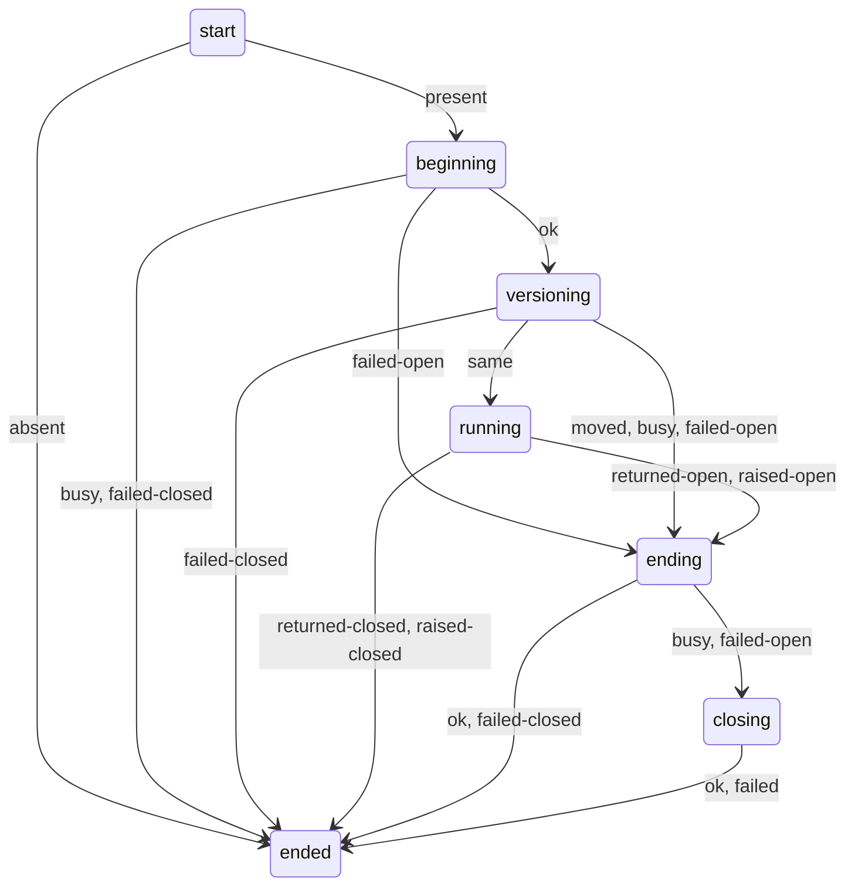

# The doorway machines

Generated from the tables in `src/techo/transaction.sls`. Do not edit.
Regenerate with `scripts/guix-env make machines`; a test fails when this file differs.

## A write job

```mermaid
stateDiagram-v2
    start --> beginning: present
    start --> ended: absent
    beginning --> versioning: ok
    beginning --> ended: busy, failed-closed
    beginning --> rolling-back: failed-open
    versioning --> running: same
    versioning --> rolling-back: moved, busy, failed-open
    versioning --> ended: failed-closed
    running --> committing: returned-open
    running --> ended: returned-closed, raised-closed
    running --> rolling-back: raised-open
    committing --> ended: ok, failed-closed
    committing --> rolling-back: busy, failed-open
    rolling-back --> ended: ok, failed-closed
    rolling-back --> closing: busy, failed-open
    closing --> ended: ok, failed
```

## A read job



## `techo serve`, from start to exit

```mermaid
stateDiagram-v2
    checking --> opening-writer: serve
    checking --> ended: refused
    opening-writer --> opening-hasher: ok
    opening-writer --> ended: raised
    opening-hasher --> opening-readers: ok
    opening-hasher --> stopping-writer: raised
    opening-readers --> serving: ok
    opening-readers --> stopping-hasher: raised
    serving --> stopping-readers: returned, refused-settings, raised
    stopping-readers --> stopping-hasher: ok, raised
    stopping-hasher --> stopping-writer: ok, raised
    stopping-writer --> ended: ok, raised
```
