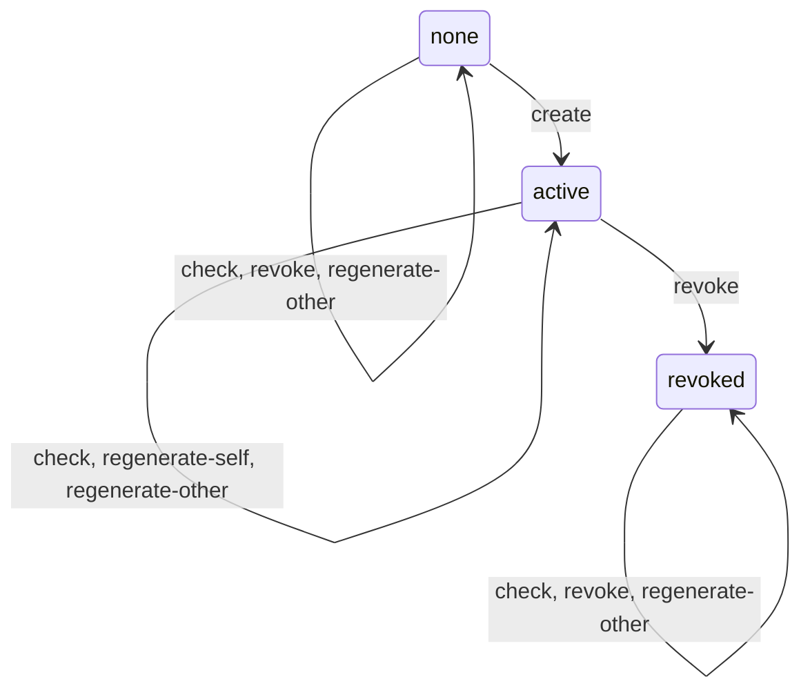

# The key machine

Generated from the table in `src/techo/keys.sls`. Do not edit.
Regenerate with `scripts/guix-env make machines`; a test fails when this file differs.

No state is an end, on purpose.

