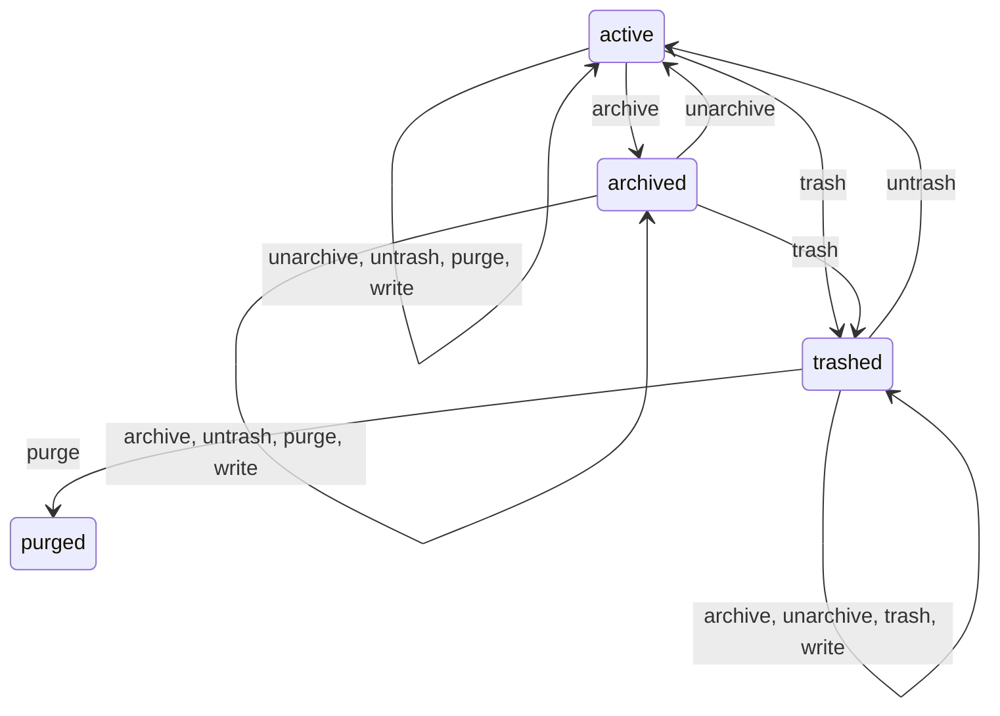

# The lifecycle machine

Generated from the table in `src/techo/nodes.sls`. Do not edit.
Regenerate with `scripts/guix-env make machines`; a test fails when this file differs.

A node starts `active`, and `purged` is the one end. `write` is a replace or a
revision's restore. A refusal and `allow` leave the state.

One function, `node-command`, answers a request from this table and the write
machine's. It looks first at what the job found:

- `none`: the write machine's answer. A state change is a 404.
- `differ`: a 412, whatever the state. Stale comes before the state.
- `match`: this table. Its refusal comes before the kind and before a missing
  snapshot. After `allow`, the write machine answers.

A purged node is found as `none`, so it never reaches this table.

## The answer each cell names

| State | archive | unarchive | trash | untrash | purge | write |
|---|---|---|---|---|---|---|
| active | -> archived, set-state | refuse-wrong-state | -> trashed, set-state | refuse-wrong-state | refuse-wrong-state | allow |
| archived | refuse-wrong-state | -> active, set-state | -> trashed, set-state | refuse-wrong-state | refuse-wrong-state | allow |
| trashed | refuse-wrong-state | refuse-wrong-state | refuse-wrong-state | -> active, set-state | -> purged, purge | refuse-wrong-state |
| purged | cannot happen | cannot happen | cannot happen | cannot happen | cannot happen | cannot happen |

## Why a cell cannot happen

| State | On | Why |
|---|---|---|
| purged | archive | a purged node is found as none, so its state is never stepped |
| purged | unarchive | a purged node is found as none, so its state is never stepped |
| purged | trash | a purged node is found as none, so its state is never stepped |
| purged | untrash | a purged node is found as none, so its state is never stepped |
| purged | purge | a purged node is found as none, so its state is never stepped |
| purged | write | a purged node is found as none, so its state is never stepped |
