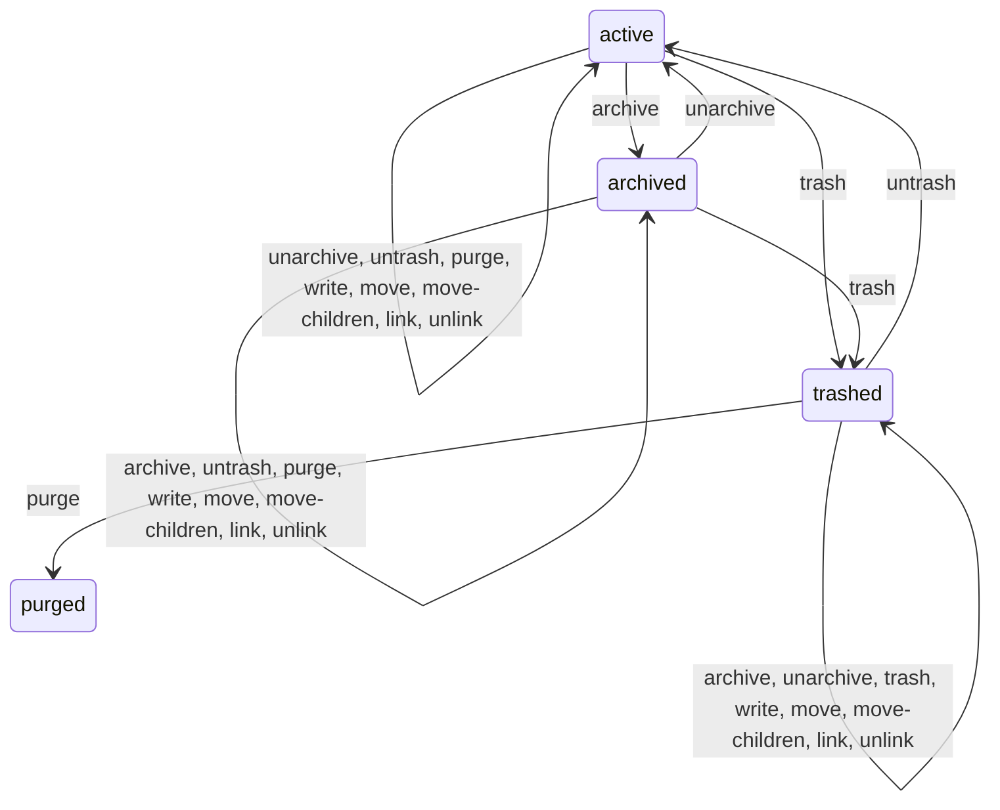

# The lifecycle machine

Generated from the table in `src/techo/nodes.sls`. Do not edit.
Regenerate with `scripts/guix-env make machines`; a test fails when this file differs.

A node starts `active`, and `purged` is the one end.
`write` is a replace, a revision's restore or a Task's transition. `move` puts
the node under a new parent; `move-children` moves its children and leaves the
node as it is. `link` makes a link with the node at either end, and `unlink`
removes one. A refusal and `allow` leave the state.

One function, `node-command`, answers every request but a link's and a Task's
transition from this table and the write machine's, with two facts more: the
verdict on the new parent, and whether the node has children. It looks first
at what the job found:

- `none`: the write machine's answer. A create's is the verdict's: an insert
  when it is `ok`. A state change, a move and a bulk move are a 404.
- `differ`: a 412, whatever the state. Stale comes before the state, and a
  create on an id in use is a 412 before its parent is judged.
- `match`: this table. Its refusal comes before the kind, before a missing
  snapshot and before the new parent. After `allow`, the write machine answers
  a write, and the verdict a move or a bulk move. A purge is refused while the
  node has children.

A purged node is found as `none`, so it never reaches this table.

`link` and `unlink` are answered by `link-command` in `(techo links)`, which
asks this table of each end: a link is made only when both ends allow `link`.
Before it asks, a missing source, or a `link`'s missing target, is a 404; a
link that is there is kept, whatever the states, or removed when the source
allows `unlink`, which every state does; and an `unlink` of a link that is
not there is a 404. `node-command` answers neither: for it they are cells
that cannot happen.

A Task's `done`, `wontdo` and `reopen` are answered by
`task-command` in `(techo tasks)`, which asks `node-command` for a replace, so
they take this table's `write`: a trashed Task takes none, and an archived one
does. Then it asks the kind, then the task's own table, [task.md](task.md).

## The answer each cell names

| State | archive | unarchive | trash | untrash | purge | write | move | move-children | link | unlink |
|---|---|---|---|---|---|---|---|---|---|---|
| active | -> archived, set-state | refuse-wrong-state | -> trashed, set-state | refuse-wrong-state | refuse-wrong-state | allow | allow | allow | allow | allow |
| archived | refuse-wrong-state | -> active, set-state | -> trashed, set-state | refuse-wrong-state | refuse-wrong-state | allow | allow | allow | allow | allow |
| trashed | refuse-wrong-state | refuse-wrong-state | refuse-wrong-state | -> active, set-state | -> purged, purge | refuse-wrong-state | refuse-wrong-state | allow | refuse-wrong-state | allow |
| purged | cannot happen | cannot happen | cannot happen | cannot happen | cannot happen | cannot happen | cannot happen | cannot happen | cannot happen | cannot happen |

## The answer each verdict names

`parent-verdict` judges the new parent. The first that applies: `ok` for the
top level, then `missing`, `trashed`, `loop`, `wrong-kind` and `too-deep`; else
`ok`.

| Verdict | Answer |
|---|---|
| ok | the request's own: insert, move or move-children |
| missing | refuse-invalid-parent |
| trashed | refuse-invalid-parent |
| loop | refuse-would-loop |
| wrong-kind | refuse-invalid-parent |
| too-deep | refuse-invalid-parent |

## Why a cell cannot happen

| State | On | Why |
|---|---|---|
| purged | archive | a purged node is found as none, so its state is never stepped |
| purged | unarchive | a purged node is found as none, so its state is never stepped |
| purged | trash | a purged node is found as none, so its state is never stepped |
| purged | untrash | a purged node is found as none, so its state is never stepped |
| purged | purge | a purged node is found as none, so its state is never stepped |
| purged | write | a purged node is found as none, so its state is never stepped |
| purged | move | a purged node is found as none, so its state is never stepped |
| purged | move-children | a purged node is found as none, so its state is never stepped |
| purged | link | a purged node is found as none, so its state is never stepped |
| purged | unlink | a purged node is found as none, so its state is never stepped |
