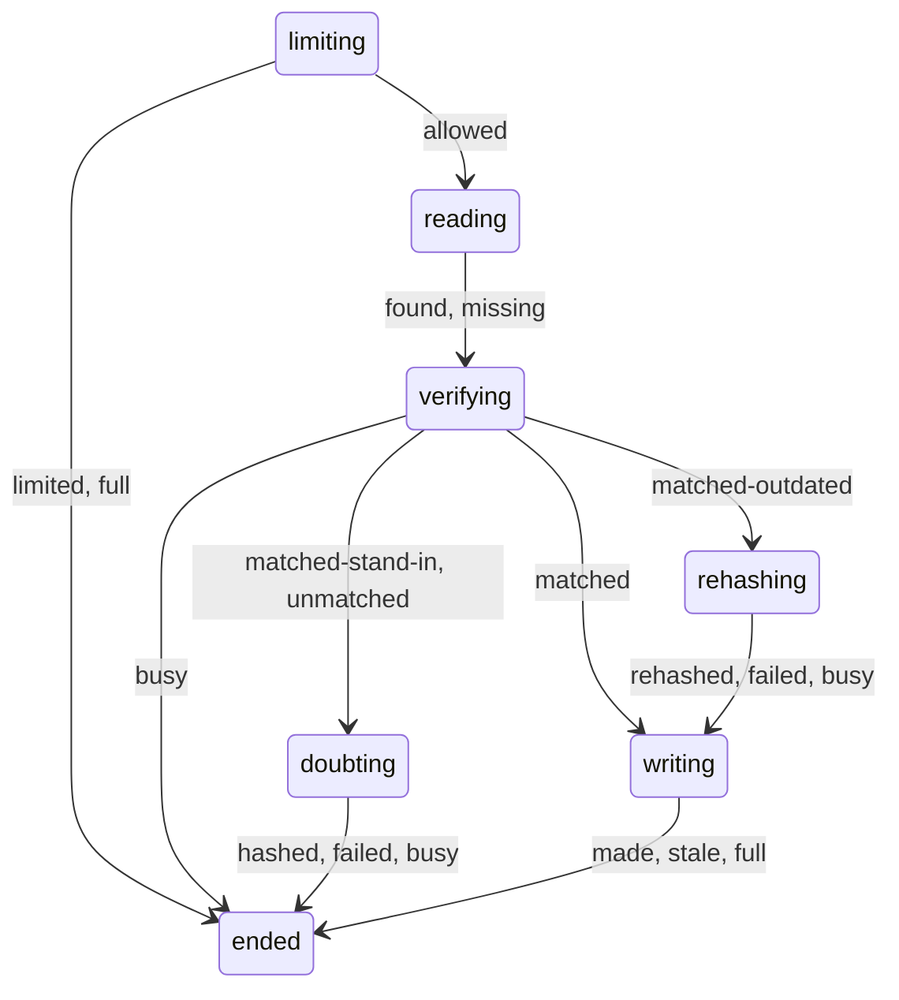

# The login machine

Generated from the table in `src/techo/login.sls`. Do not edit.
Regenerate with `scripts/guix-env make machines`; a test fails when this file differs.

It starts in `limiting` and ends in `ended`.

## How each ending answers, and what it does to the try's count

| From | On | Answer | The count |
|---|---|---|---|
| limiting | limited | 429 rate_limited | kept |
| limiting | full | 429 rate_limited | kept |
| verifying | busy | 503 unavailable | forgiven |
| doubting | hashed | 401 invalid_credentials | kept |
| doubting | failed | 503 unavailable | forgiven |
| doubting | busy | 401 invalid_credentials | kept |
| writing | made | 201 created | cleared |
| writing | stale | 401 invalid_credentials | kept |
| writing | full | 409 too_many_keys | cleared |
