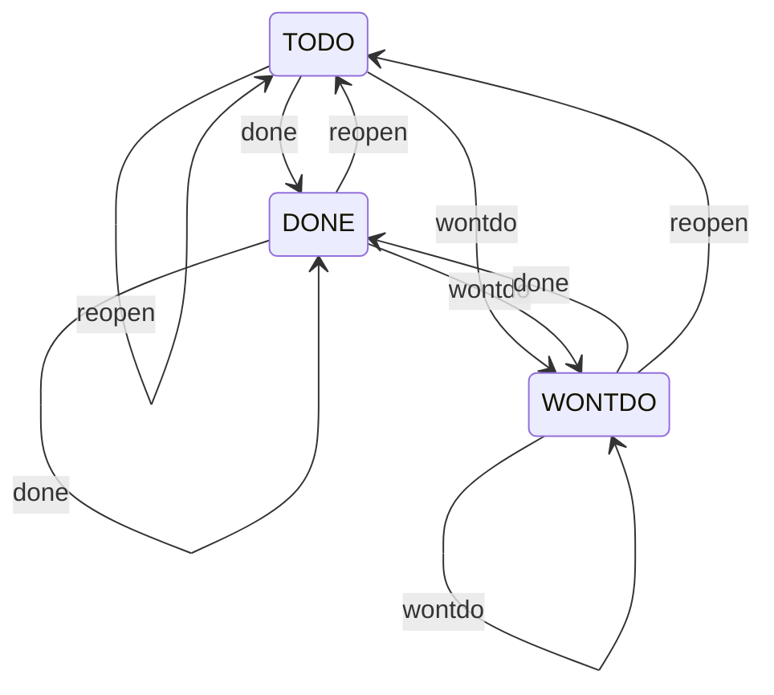

# The task machine

Generated from the table in `src/techo/tasks.sls`. Do not edit.
Regenerate with `scripts/guix-env make machines`; a test fails when this file differs.

A Task's status is `TODO`, `DONE` or `WONTDO`. A create may give any of them;
after that only `done`, `wontdo` and `reopen` change it, each its own command.
Every move between two different statuses is allowed. The table has no end, on
purpose: a Task may be closed and reopened for ever.

`close` sets `closed` to the write's time, `keep` leaves it, and `open` removes
it. A refusal leaves the status.

One function, `task-command`, answers a transition. It asks `node-command` in
`(techo nodes)` as for a replace, then the kind, then this table. The first
that applies:

1. no node: `refuse-404`;
2. stale: `refuse-412`, whatever the state;
3. the node's state: a trashed node takes none, `refuse-wrong-state`. An
   archived Task takes one, as it takes a replace;
4. the kind: a node that is no Task, `refuse-not-a-task`;
5. this table: `refuse-wrong-status`, or the cell's command and next status.

## The answer each cell names

| Status | done | wontdo | reopen |
|---|---|---|---|
| TODO | -> DONE, close | -> WONTDO, close | refuse-wrong-status |
| DONE | refuse-wrong-status | -> WONTDO, keep | -> TODO, open |
| WONTDO | -> DONE, keep | refuse-wrong-status | -> TODO, open |

Every cell has a row: no cell cannot happen.
