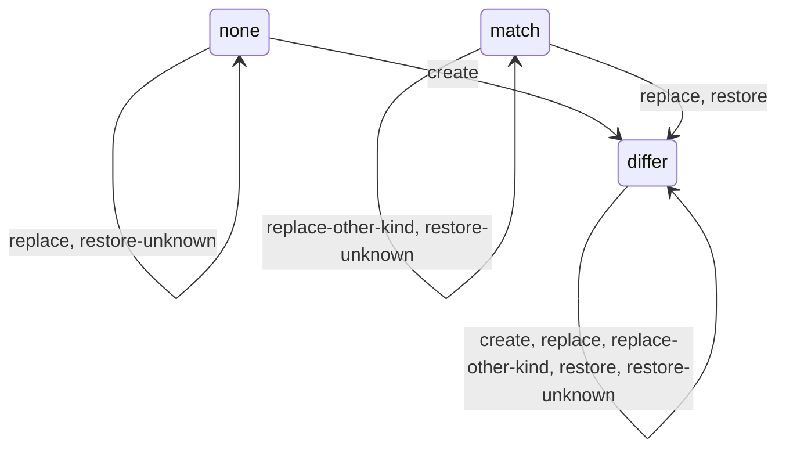

# The write machine

Generated from the table in `src/techo/nodes.sls`. Do not edit.
Regenerate with `scripts/guix-env make machines`; a test fails when this file differs.

A write starts in what its job found: `none`, no node; `match`, the node at
the revision given; `differ`, the node at another revision, or a create's id
in use. The next state is what the same request would find if sent again. No
state is an end, on purpose.

## The command each cell names

| Found | create | replace | replace-other-kind | restore | restore-unknown |
|---|---|---|---|---|---|
| none | insert | refuse-404 | cannot happen | cannot happen | refuse-404 |
| match | cannot happen | write | refuse-409 | copy | refuse-404 |
| differ | refuse-412 | refuse-412 | refuse-412 | refuse-412 | refuse-412 |

## Why a cell cannot happen

| Found | On | Why |
|---|---|---|
| none | replace-other-kind | no node was found, so there is no stored kind to differ from |
| none | restore | no node was found, so it has no snapshot to restore |
| match | create | a create gives no revision, so it never matches one |
